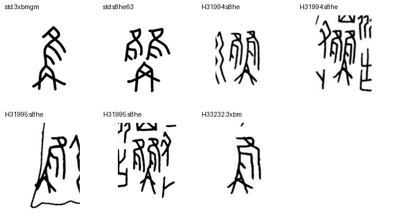

# 考释笔记：OBIMD UID `3xbmgmm4j0`（`U+C9B7A` / `U+C9B76`）——历组二类「其 __ 眾，告于父丁一牛」未释动词考释

> **【字形与原摹本图版预览 — 先看原字，再读考释】**
>
> 

- **作者 / 整理**：Gemini（独立考释笔记 #5，2026-11-26；2026-11-28 增补顶置原摹本图版）
- **结论**：**存疑（11/20）**。本字是经 Rule 7 文献排重后确认的**真实未释动词**（`5 tokens / 3 片`，全部 clean token；公开学术释文对《合集》31995 本字位即作空框 `[ ]` 处理）。全库 10,077 条卜辞实测表明，进入 `其 X 眾` 槽位的动词仅有 3 个：`喪`（5）、`雉`（4）与本字（2）；又于 `H31994`、`H31995` 与禁止副词 `弜`（=勿）直接配对作 `弜 __`，决定性锁定其为**可控的商王动员／召集／处置「眾」之及物动词**（绝非不可控的「喪」）。原摹本裁图证实主子形 `s8he63vkfc`（4/5 例）为**双鸟／双羽形置干木／大之上**，与「集（`/*dzub/` / `/*dz[u]p/`）」／「雔（双鸟）」构意高度呼应，惟尚缺先秦金文／简帛过渡字形与直接音韵铁证，严格维持 **`存疑`**。
- **状态**：未释（已收入 `kaoshi/images/crops_3xbmgmm4j0.png` 全部 5 例原摹本实测图版）。

---

## 0. 标识、频次与口径（OBIMD 本地实测）

- **OBIMD UID**：`3xbmgmm4j0`；平臺 codepoint **`U+C9B7A`**；transcription `['U+C9B7A', 'U+C9B76']`（均属第 12 平面未分配区，Unihan 无码位、无读音，PUAONLY 池）。
- **本地重数频次**：**5 tokens / 3 片，全部 clean token**（`SeatFont = 0`, `Mark = -1`），全为《合集》号（`H31994` ×2、`H31995` ×2、`H33232` ×1），HD 0 例。
- **子字形分叉（SubLabel）**：
  - `s8he63vkfc`：4 例（`H31994` ×2、`H31995` ×2）——**上部为并列双羽／双鸟形，下部为尖顶分叉支架（似木／大／介）**；
  - `3xbmgmm4j0`：1 例（`H33232`）——**上部为单羽／单鸟形，下部同为尖顶分叉支架**。
- **断代分期**：《合集》31994、31995 属商代**历组二类（历二）**卜辞（告祭父丁一牛）。

---

## 1. 全部 5 例原辞与全库平行槽位统计（OrderNumber 排序、codepoint 核对）

| 合集号 | 句组 | 完整逐 token 序列（本字作 `__`） | 位置与子形 |
|---|---|---|---|
| **H31994** | InscriptionSentence2 | `弜 __` | 禁止副词 `弜` 后、句末（`s8he63vkfc`） |
| **H31994** | InscriptionSentence3 | `己 丑 卜 其 __ 眾 告 □ 父 丁` | `其` 后、`眾` 前（`s8he63vkfc`） |
| **H31995** | InscriptionSentence1 | `弜 __` | 禁止副词 `弜` 后、句末（`s8he63vkfc`） |
| **H31995** | InscriptionSentence2 | `己 丑 卜 其 __ 眾 告 于 父 丁 一 牛` | `其` 后、`眾` 前（`s8he63vkfc`） |
| **H33232** | InscriptionSentence2 | `□ 酉 卜 于 □ 告 龝 __` | `告龝` 后、句末（`3xbmgmm4j0`） |

### 1.1 Rule 7 外部文献排重核验
- 公开学术文献（如立命馆大学及历组告祭专题文献）对《合集》31995（历二）与 31994 均转写为：**`己丑卜，其 [ ] 眾，告于父丁一牛`**，本字位置明确留空 `[ ]` 未释，排除“OBIMD 漏标已释字”的可能。

### 1.2 全库平行槽位铁证（OBIMD 10,077 条记录实测）
1. **`其 X 眾` 全库仅 3 词**（`n = 11`）：
   - `喪`（`49lxhylgu1`）：**5 例**（失丧众人，不可控灾变）；
   - `雉`（`kfdhplatyr`）：**4 例**（陈列／点检／动员众人，从矢从隹）；
   - **本字 `3xbmgmm4j0`**：**2 例**（`H31994`、`H31995`）。
2. **`X 眾` 全库高频前 8 词**：`以`（17）、`喪`（13）、`貞`（9）、`雉`（9）、`令`（6）、`乎`（5）、`告`（2）、**本字（2）**。
3. **决定性语法约束——`弜 __` 对贞（H31994、H31995）**：
   - 甲骨文中 **`弜`**（`jiàng`）为标准祈使禁止副词（相当于「勿／不要」），**只修饰可控意愿动词**。`其 __ 眾` 与 `弜 __` 正反并列，一举排除：
     - 不可控灾变义动词（如「喪」——商人占问「其喪眾」表担忧，不会以祈使禁止「弜喪」命令自己“不要损失”）；
     - 各类名词与专名（`弜` 后必接谓语动词）。
   - 结论：**本字 100% 是商王对「眾」（殷商平民／征发武装）实施某项可控行动，且行动前须以一牛告祭父丁的及物动词**（动员、集结、检阅、编组或祭祓众人）。

---

## 2. 字形解剖与摹本实证（形）

全部 2 张标准图与 5 例 `facsimile.zip` 裁切拼图已入库：**`kaoshi/images/crops_3xbmgmm4j0.png`**（对照已知字见 `kaoshi/images/survivors_vs_known.png`）。

- **主子形 `s8he63vkfc`（H31994 ×2、H31995 ×2，4 例摹本清晰一致）**：
  - **上部**：左右并列**两枚完全同构的侧视鸟／羽形（或长羽冠人形）**——每枚均具尖锐鸟首／冠喙、弧背及向斜下方伸出的 3–4 根平行羽状短笔；
  - **下部**：一枚尖顶（`∧`）加交叉斜笔与两足的支架形（近 `木` 根或 `大`/`介`/`矢` 尾）。
- **单羽变体 `3xbmgmm4j0`（H33232，1 例）**：上部省为单枚鸟／羽形，下部同。甲骨文双构件省作单构件属常态（参「集」从三隹或一隹、「從」从二人或三人），但因 `H33232` 处于 `告龝 __` 句末而无「眾」，单／双两子形是否严格同字留作证伪项。
- **已比对排除之邻字**：`老`（`nufbzasiq7`，长发人形，无双鸟无底架）、`長`（`14fcc90wdg`）、`喪`、`雉`（矢＋单隹）。

---

## 3. 竞争假说与双系上古音核对（音、义）

| 候选方向 | 构形理据 | 郑张尚芳（2003） | Baxter–Sagart（2014 v1.1） | 评述 |
|---|---|---|---|---|
| **A. 「集（雥）」类字（集结／聚合众人，领先假说）** | 双鸟（`雔`）栖于 `木` 上（《说文》：`雥，群鸟在木上也，从雔从木`；`集`，`雥` 省），与本字 `双鸟＋底架` 构意高度逼近 | `*dzub`（从母缉部） | `*dz[u]p` | 完美契合「其集眾，告于父丁一牛 / 弜集」（动员集结众人前告祭祖先）；**短板**：下部底架更近尖顶 `介/大/矢` 而非典型甲骨文 `木`（`j29igjvgwl` 呈 Y 叉顶＋分枝根），且 OBIMD 尚须核对已有 `集` 字头异体 |
| **B. 「雉」的繁化同源动词（双隹＋矢）** | 卜辞 `其雉眾`（4 例）与 `其 __ 眾`（2 例）严密平行；若下部实为倒 `矢` 尾而上部由单隹繁为双隹，则与「陈列／检阅众人」之 `雉` 同族 | `雉` `*lʼiʔ`（澄母脂部） | `*[d]rijʔ` | 语槽契合度极高；**短板**：下部非标准甲骨 `矢` 形（无箭头横杠），且 `雉` 与本字在同组卜辞中是否互补未核 |
| **C. 「毛／羽／翿」饰礼仪动词（执羽舞祓众）** | 上部三四根平行斜笔似羽饰／毛羽，表执羽饰行礼于众人 | — | — | 与 `H33232 告龝 __`（秋祭）较合，但无传世对应单字可锁音 |

---

## 4. 四环打分

| 环 | 得分 | 评分依据 |
|---|---|---|
| **形** | **3/5** | 5 例原摹本全核（`crops_3xbmgmm4j0.png`），双鸟／羽＋底架结构清晰可辨；扣 2 分因下部构件（木／矢／介）及单双子形分合未定 |
| **音** | **1/5** | 仅依构意提示「集／雥（缉部）」或「雉（脂部）」语义—构形类比，无谐声通假铁证 |
| **义** | **3/5** | `其 __ 眾`＋`弜 __` 铁证锁死为「商王对眾实施的可控动员／集结／检阅动词」；扣 2 分因具体动词归属未定 |
| **用** | **4/5** | 全库平行槽排他性极强（`其 X 眾` 仅 3 词），历二期《合集》31994/31995 正反对贞完整；扣 1 分因样本仅 5 例／3 片 |
| **合计** | **11/20** | **结论：存疑**（已通过 Rule 7 排重的优质真未释高潜动词） |

---

## 5. 证伪条件与未核查事项

1. **《新甲骨文编》与《甲骨文字综理表》（2024）**：按「双隹／双鸟＋木／大」查「集」「雥」「雉」字头异体表及附录未识字，检验本字是否已被归入「集」或「雥」异体。
2. **全量《合集》「眾」字卜辞检核**：排查 OBIMD 之外的《合集》历组二类「眾」卜辞，检查是否存在本字与 `雉` 或 `集` 的同文对读例。
3. **《合集》33232 完整拓片复核**：确认单羽形 `3xbmgmm4j0`（`告龝 __`）是否确与双羽形 `s8he63vkfc` 同字。
4. **未核查事项**：未查纸本《合集释文》《新甲骨文编》《类纂》；OBIMD 中「集」无独立 CJK 字头供本地标准图比对。

---

## 6. 参考文献与工作资产

- OBIMD 本地实测：`data.json`（10,077 条）、`Main-character.json`（3,936 UID）、`facsimile.zip`、`subchar-images.zip`（CC-BY 4.0，*Scientific Data* 2026，DOI `10.1038/s41597-026-06967-0`）。
- 图版资产：`kaoshi/images/crops_3xbmgmm4j0.png`（2 标准图＋5 原摹本裁切）、`kaoshi/images/survivors_vs_known.png`。
- 外部文献：立命馆大学及历组告祭研究文献引《合集》31994/31995（历二）作 `己丑卜，其 [ ] 眾，告于父丁一牛`；张玉金对《合集》31995 之历组断句考辨；郑张尚芳《上古音系》（2003）；Baxter–Sagart（2014 v1.1）。
