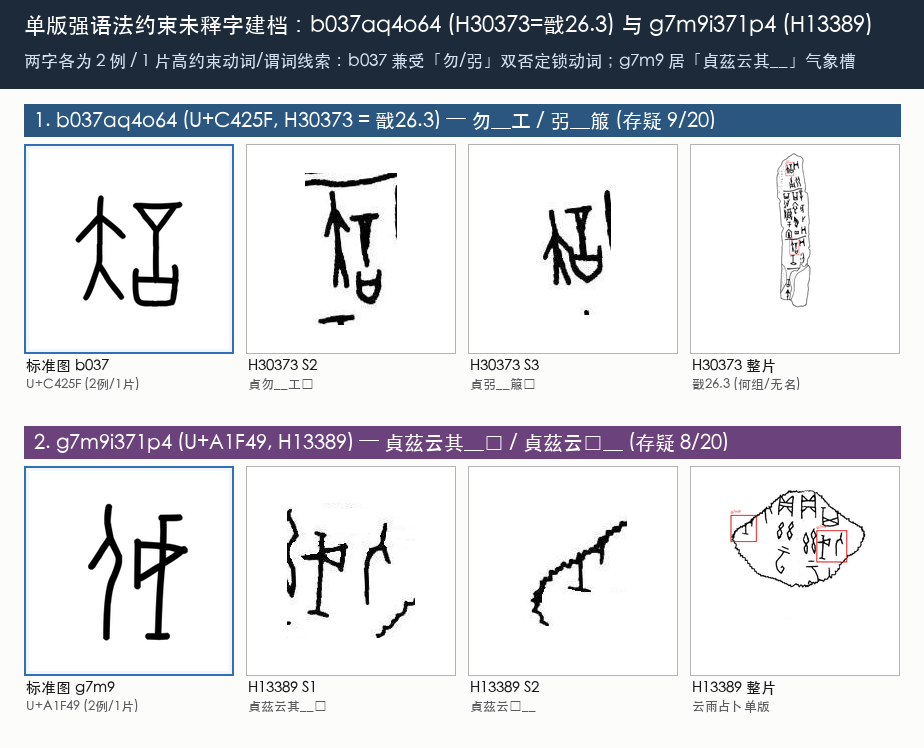

# 考释笔记：OBIMD 单版高语法约束未释字建档——`b037aq4o64`（《合集》30373 = 《戩》26.3）与 `g7m9i371p4`（《合集》13389）

> **【字形与原摹本图版预览 — 先看原字，再读考释】**
>
> 

- **作者 / 整理**：Gemini（独立考释笔记 #9，覆盖 2 个 OBIMD 单版高约束目标，2026-11-28）
- **结论**：**双双严格维持 `存疑`（`b037aq4o64` 9/20、`g7m9i371p4` 8/20）**。在 OBIMD 剩余低频尾池（`clean ≤ 4`）中，绝大多数条目的语境信息极度贫乏或属专名；但经局部筛选，以下两枚**单版双例**（各 `2 clean / 1 片`）却具备罕见的强语法锁死条件：
  1. **`b037aq4o64`（`U+C425F`，`H30373 = 《戩》26.3`）**：同版 S2、S3 分别以 **`勿 __ 工 □`** 与 **`弜 __ 箙 □`** 出现——同时受商代两大祈使禁止副词 **`勿`** 与 **`弜`** 修饰，100% 锁定为**可控及物动词**；
  2. **`g7m9i371p4`（`U+A1F49`，`H13389`）**：同版 S1、S2 均居 **`貞 茲 云 其 __ □` / `貞 茲 云 □ __`** 之云雨气象谓词槽位，锁定为**修饰或描述云雨状态的气象谓词**。
  两字均受限于**单版仅 2 例**的样本量天花板与完全空白的音环，绝不可称破译，仅作诚实的高约束线索建档，严格定性为 **`存疑`**。
- **附注（为何不为 `0fig5rmiox` 单列未释考释笔记）**：同批检出的 `0fig5rmiox`（`U+F3206`，5 clean / 4 片：`H14348`、`H14349`、`H14350`、`H14358`）经 Rule 7 外部文献查核，蔡哲茂（1987，《殷卜辭「伊尹龜（舅）示」考》）已将此组卜辞释为「**求示**」（即伊尹舅示），且原摹本与 OBIMD「`求`」（`aki498y6jc`）高度近似（见 `kaoshi/images/audit_0fig5rmiox_vs_qiu.png`）。依「已释／高危疑似未归并异体不单列未释笔记」原则，已将其归入 `docs/EXCLUSION-LIST-2026.md` 与 `reports/gemini-reply-to-muse-2026-11-28.md` 拦截建档，不列为本笔记目标。

---

## 0. 标识、频次与口径（OBIMD 本地实测）

| 字段 | 目标一：`b037aq4o64` | 目标二：`g7m9i371p4` |
|---|---|---|
| **OBIMD 池 / 码位** | PUAONLY；`U+C425F`（tr: `['U+C425F']`） | PUAONLY；`U+A1F49`（tr: `['U+A1F49', 'U+A4A44']`） |
| **Unihan 核查** | 第 12 平面未分配区，无码位无读音 | 第 10 平面未分配区，无码位无读音 |
| **本地重数频次** | **2 tokens / 1 片，全部 clean**（`SeatFont = 0`, `Mark = -1`） | **2 tokens / 1 片，全部 clean**（`SeatFont = 0`, `Mark = -1`） |
| **著录与片号** | **`H30373`**（旧著录核实：**`《戩壽堂所藏殷虛文字》26.3`**，何组／无名组） | **`H13389`**（气象云雨占卜单版） |
| **子字形（SubLabel）** | 单一子形 `b037aq4o64`（2/2） | 单一子形 `g7m9i371p4`（2/2） |

---

## 1. 目标一：`b037aq4o64`（《合集》30373 = 《戩》26.3）考释

### 1.1 `H30373` 全片原辞实测（OrderNumber 排序、codepoint 核对）

| 句组 | 完整逐 token 序列（本字作 `__`） | 语法与语境诊断 |
|---|---|---|
| **S1** | `辛 亥 卜 貞 其 卒 翌 日 其 延 𱀵[snlsmzwecl] 于 室` | 同片序辞与祭仪背景（干支辛亥，涉宗室祭祀延礼） |
| **S2** | `貞 勿 __ 工 □` | 祈使禁止副词 **`勿`** 直接修饰本字，后接宾语 **`工`**（职官／工匠／祭礼器或地名） |
| **S3** | `貞 弜 __ 箙 □` | 祈使禁止副词 **`弜`**（= 勿）直接修饰本字，后接宾语 **`箙`**（箭囊／职官／人名或祭用器） |

**槽位铁证**：
- 商代卜辞中 **`勿`** 与 **`弜`** 均为典型的祈使禁止副词（「不要／勿」），专饰**可控意愿动词**；
- 同一版上紧邻两辞分别出现 `勿 __ 工 □` 与 `弜 __ 箙 □`，形成极为罕见的**「双否定副词＋双及物宾语（`工` / `箙`）」**交叉约束——100% 排除人名、地名、静态器物名与不可控状态词，铁板锁定为**可控及物动词**；
- 唯一弱点在于 `S2`、`S3` 句末皆残（`□`），且全库仅此单版 2 例，无法进一步靠跨片共现锁定该动词是「差遣／征召（工、箙）」还是「祭用／撤除（工、箙）」。

### 1.2 字形解剖（形）

见顶部 `crops_b037aq4o64_g7m9i371p4.png` 上排（标准图 + `H30373 S2`/`S3` 原摹本 + 整片定位）：
- **左旁**：清晰的侧面立人／大／矢系竖形（一长竖干，中部左右斜伸短臂／双足，呈人形 `亻`/`人` 或立 `大` 状），`S2`、`S3` 两摹本完全一致；
- **右旁**：上部为一倒三角（`▽`，顶平底尖），中接短竖，下部承一平底敞口方器（`凵`/`口` 内或有一横），整体颇似某种倒置锥形／杯形器物置皿口之上（结构略近「`豆`」「`酉`」「`工`＋`口`」或「`去`/`告`」类构件，然与 OBIMD 中 `豆`、`酉`、`工`、`告` 主形均不逐笔重合）；
- 两例原摹本笔画极清晰，无漫漶残断，左旁＋右旁结构 100% 稳定。

### 1.3 四环打分（`b037aq4o64`）

| 环 | 得分 | 评分依据 |
|---|---|---|
| **形** | **3/5** | `H30373 S2/S3` 原摹本清晰稳定，左右双构件边界分明；扣 2 分因右旁「倒三角＋竖＋平底口器」身份未识别，无金文／小篆直系对应 |
| **音** | **0/5** | 无可立声符，无通假与后代字形线索 |
| **义** | **3/5** | 同版兼受 `勿`、`弜` 双禁止副词修饰并带宾语 `工`、`箙`，100% 锁定为可控及物动词；扣 2 分因具体动作义未定 |
| **用** | **3/5** | 语法槽位约束极强；扣 2 分因全库仅单版 2 例（`H30373`），且两句末字皆残 |
| **合计** | **9/20** | **结论：`存疑`** |

---

## 2. 目标二：`g7m9i371p4`（《合集》13389）考释

### 2.1 `H13389` 原辞实测与「茲云」语料严格分层对照

| 句组 | 完整逐 token 序列（本字作 `__`） | 摹本实况与槽位诊断 |
|---|---|---|
| **H13389 S1** | `貞 茲 云 其 __ □` | 居「`茲云其 __`」气象谓词槽位，字形完整清晰 |
| **H13389 S2** | `貞 茲 云 □ __` | 居「`茲云 □ __`」对称复贞槽位；**原摹本实测提示**：`S2` 本字遭**骨面断缘斜切**，仅存右半竖杠与底横残笔（见顶部图版下排第 3 格） |

**全库「茲 + 云」本地实测 vs 外部文献对照（严格区分口径，绝不混淆）**：
1. **OBIMD 本地 `data.json` 全量实测（共 6 句 / 5 片）**：
   - `H5600 S3`：`貞 茲 云 雨`
   - `H13386 S1`：`庚 寅 貞 茲 云 其 雨`
   - `H13387 S2`：`貞 茲 云 其 雨`
   - **`H13389 S1`：`貞 茲 云 其 __ □`**（本字）
   - **`H13389 S2`：`貞 茲 云 □ __`**（本字）
   - `H13394 S1`：`□ 宜 今 茲 云 □`
2. **外部已刊文献平行句（不在 OBIMD 本地语料内，诚实单列）**：
   - 台湾大学学术检索（`ntu.edu.tw`）所引同段气象卜辞 **`《合集》13392`**：**`貞 茲 云 延 雨`**（「这片云将连绵降雨」）。
   - **语义启示**：在 `H13386–H13394` 这一高度集中的「`茲云`」云雨占卜号段中，紧接 `茲云（其）` 之后出现的词要么是核心气象动词 **`雨`**（下雨），要么是修饰降雨情状的状语／助动词（如 `H13392` 的 **`延`**［连绵］），亦或表云势消散／聚集／蔽日之气象谓词（参本库 `aelrb19u0i` 之 `[不/其/亦] __ 雨`）。`H13389 S1` 之 `__` 后尚有一残字 `□`（极可能即「`雨`」字残失，构成 `茲云其 __ 雨`，与 `H13392 茲云延雨` 逐字平行），`S2` 之 `□` 位于 `云` 与 `__` 之间（或即 `其`/`不` 残失），故 `g7m9i371p4` 已高度锁定于**云雨气象谓词／情状修饰动词**语义场。

### 2.2 字形解剖（形）

见顶部 `crops_b037aq4o64_g7m9i371p4.png` 下排：
- **标准图与 `H13389 S1` 完整摹本**：左右结构（或 `S1` 似三段）——左侧为一曲折长竖带中侧枝（略近 `彳` 或曲 `人` 形），右侧为一长竖贯穿中部斜置方框／菱框、底部承一短平横（颇近「`中`」「`史`」或「`尹`/`事`」类竖贯方框之形）；`S1` 右侧另见一弧线，经整片定位确认属同片邻字或刻痕边界；
- **`H13389 S2` 摹本**：因骨片左上断缘斜切，仅保留右侧「竖＋底横」下半截，单凭 `S2` 无法独立复原全形，依赖 `S1` 与对称句式归并。

### 2.3 四环打分（`g7m9i371p4`）

| 环 | 得分 | 评分依据 |
|---|---|---|
| **形** | **2/5** | `S1` 字形清晰（左曲竖＋右竖贯框带底横），但 `S2` 遭断缘斜切仅存残笔，构件身份及与「`延`/`𠂤`/`中`」等关系均未定 |
| **音** | **0/5** | 无可立声符，无通假与金文／简帛平行 |
| **义** | **3/5** | `茲云其 __` 与同号段 `H13386/13387/13392` 锁定为云雨气象谓词／情状修饰字；扣 2 分因具体气象词义（延雨？散云？覆雨？）未定 |
| **用** | **3/5** | 句式高度工整，同段平行句清晰；扣 2 分因全库仅单版 2 例且 `S1`/`S2` 皆伴残字与断缘 |
| **合计** | **8/20** | **结论：`存疑`** |

---

## 3. 证伪条件与未核查事项

1. **纸本《甲骨文合集释文》核查**：
   - 核查 **`H30373`（`《戩》26.3`）** 印本释文（`odict.net` / `jiagu.ca` 已确认新旧号对照，但 `S2/S3` 本字位之权威隶定未见于公开摘要）；若印本已给出学界公认今字读法，则按 Rule 7 改判移出未释池；
   - 核查 **`H13389`** 印本释文及 `H13386–H13394` 整段云雨卜辞，检验 `H13389 S1` 句末残字是否确为「`雨`」，以及本字是否已被释为某已知气象字。
2. **《新甲骨文编》与《甲骨文字综理表》（2024）**：按构形分别核检 `b037aq4o64` 与 `g7m9i371p4` 是否收入已释字头异体表或附录未识字。
3. **跨片新用例**：若在《合集》OBIMD 以外部分、《合补》或《屯南》中检得二字的第二片用例，须重算频率并检验是否维持现有动词／气象谓词锁定。

---

## 4. 参考文献与工作资产

- OBIMD 本地实测：`data.json`、`Main-character.json`、`facsimile.zip`、`subchar-images.zip`（CC-BY 4.0，*Scientific Data* 2026，DOI `10.1038/s41597-026-06967-0`）。
- 外部文献对照：`odict.net` / `jiagu.ca` 著录对照（`《合集》30373 = 《戩》26.3`，何组）；台湾大学学术检索（`ntu.edu.tw`）引 `《合集》13392`「`貞茲云延雨`」。
- 图版资产：`kaoshi/images/crops_b037aq4o64_g7m9i371p4.png`；相关 Rule-7 拦截图版：`kaoshi/images/audit_0fig5rmiox_vs_qiu.png`。
