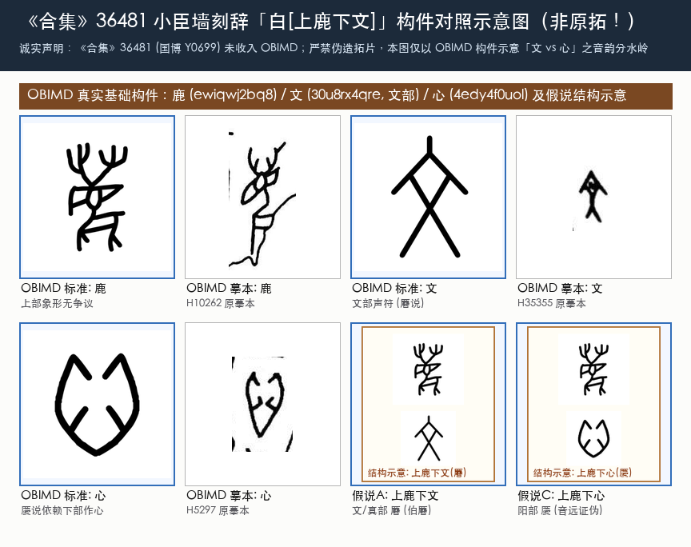

# 考释笔记：《合集》36481 小臣墙刻辞「白[⿱鹿文]」——字源释「麐」与辞例读俘酋「伯麐」之分层假说

> **【构件对照示意图预览 — 先看构形分水岭，再读考释】**
>
> 
>
> *(诚实注记：《合集》36481〔中国国家博物馆藏 Y0699〕未收入 OBIMD 语料库；上图严禁伪造原拓，仅以 OBIMD 真实「鹿」「文」「心」标准形与原摹本直观演示假说 A「上鹿下文＝麐」与假说 C「上鹿下心＝慶」之构形与音韵分水岭。)*

- **作者 / 整理**：Gemini（独立考释笔记 #2，2026-11-26；2026-11-28 增补顶置构件对照示意图）
- **结论**：**存疑（12/20）**。本笔记针对晚商著名战争纪事刻辞《合集》36481（中国国家博物馆藏 Y0699，小臣墙刻辞）中争议甚久的 **`白[⿱鹿文]`** 提出**分层综合假说**：**字源本释为从鹿、文声之「麐」（上古文／真部 `*m·rin` / `*C.r[ə][n]`），而辞例语境中读为被俘危方方伯人名「伯麐」**。此说既以双系上古音彻底证伪传统阳部「慶」说，又化解了「在两例杀敌酋人牲之前突兀献祭一头神话白麒麟」的礼制张力；惟因原骨 Y0699 下部构件究竟作「文」抑或作「心」尚缺高清微距实核，且甲骨孤证频次极低，严格维持 **`存疑`**，不称「成立」。
- **状态**：未定（核心证伪取决于国博原骨 Y0699 高清微距核验）。

---

## 0. 标识、编码辨析与文献边界

- **精确结构描述**：**`[⿱鹿文]`**（上下结构：上「鹿」、下「文」）。
- **编码陷阱严正区分**：电子排印与网络文献中常权宜借用 Unicode **`𪊓`（`U+2A293`，CJK 扩展 C 区，IDS `⿸鹿文`）** 代排本字；**务必明确区分原拓实际上下结构 `⿱鹿文` 与电子代用码 `𪊓`（`⿸鹿文`）**，切勿将字体排版的半包围结构误当作殷商原刻构形。
- **载体与藏地**：**《甲骨文合集》36481**（小臣墙刻辞，于省吾旧藏，现藏**中国国家博物馆，编号 Y0699**），牛骨刻辞，正面残存 **55 字**，反面刻有 **36 字干支表**。
- **近期文献边界说明（防止误引）**：2024 年《甲骨文与殷商史·新十四辑》刊发之 **郑舒婷《小臣墙刻辞“𣪊”字再探》** 与 **张博伦、马保春《“弧”字补说》**，所考均系该片战利品记载段中的其他残损或疑难字，**并非**本笔记所考之 `白[⿱鹿文]`；学术引用时须严加区分。

---

## 1. 已核实原辞与金文平行用例

### 1.1 《合集》36481 正面核实释文（残 55 字）

> `[……]小臣墙比伐，擒危髦[……]廿，人四，馘千五百七十……又（侑）白[⿱鹿文]于大乙，用白（伯）印于祖乙，用髦于祖丁，甘京。易（赐）[……]`

**辞例结构解剖（决定性句法排比）**：
献祭段紧承战争擒获战果（「擒危髦……人四，馘千五百七十……」），呈现严格的三连平行献祭结构：

| 序次 | 祭祀动词 | 献祭对象 | 受祭先王 |
|---|---|---|---|
| 1 | `又（侑）` | **`白[⿱鹿文]`** | `于大乙` |
| 2 | `用` | **`白（伯）印`**（危方俘酋） | `于祖乙` |
| 3 | `用` | **`髦`**（危方俘酋，前文作「擒危髦」） | `于祖丁` |

三句受祭先王依次为商朝立国与中兴三大直系先王（大乙 → 祖乙 → 祖丁），第二、第三句的献祭对象「伯印」「髦」皆为明确的人牲（危方首领／方伯），且「白印」之「白」在卜辞中明确读为爵称「**伯**」。

### 1.2 两周金文平行字例

- **《伯其父簠》（《集成》4581）**：同源从鹿从文（类）字形明确用作**人名**，直接证明该字具有充当贵族／方伯专名用字的先秦语用传统。
- **《秦公簋》**、**《叔匜》**：西周晚期至春秋金文中从「鹿」关联构形之演变样本，为考察「鹿＋文」与「鹿＋心」（慶）之形体离合提供历时参照。

---

## 2. 字形分析（形）

- **主结构**：上部为完整侧面立鹿象形（「鹿」），下部构件呈交错「文」形（学界亦有人疑其为「心」之变形或混写）。
- **构形张力**：
  - 若下部确为 **`文`**，则本字为标准**形声字：从鹿、文声**（即《说文》类「麐／麟」之早期形声构造）；
  - 若下部实为 **`心`**（或「鹿＋心＋夊」之省），则与西周金文以来「慶」字之早期构形接近。
- **形环评价（3/5）**：上部「鹿」毫无疑问，且有《伯其父簠》等金文平行；扣 2 分因尚未直接检视国家博物馆 Y0699 原骨高清微距照片，无法对下部笔画究竟作「文」还是作「心」作物理级终审。

---

## 3. 上古音核对（音，双系对照）

采用郑张尚芳（2003）与 Baxter–Sagart（2014 v1.1）双系构拟检验「麐／麟」说与「慶」说：

| 汉字 | 郑张尚芳（2003） | Baxter–Sagart（2014 v1.1） | 韵部 | 音韵适配评述 |
|---|---|---|---|---|
| **文** | `*mɯn` | `*mə[n]` | 文部 | 本字下部声符（唇音鼻音＋`-n` 尾） |
| **吝** | `*m·rins` | `*mə.rə[n]-s` | 文／真部 | 从「文」得声的经典复辅音中介字 |
| **麐 / 麟** | `*m·rin` | `*C.r[ə][n]` | 真／文部 | **与「文」「吝」声韵链条严丝合缝** |
| **慶** | `*kʰraŋs` | `*[kʰ]raŋ-s` | 阳部 | **音韵格格不入**：溪母软腭音＋`-ŋ` 尾，与文部 `*mɯn` 绝无谐声可能 |

**音环核心裁决（4/5）**：
1. 只要原骨下部构件确为「文」，则本字在音韵上**必然落入 `文 → 吝 → 麐／麟` 这一严密的文／真部谐声链**；
2. 传统将从鹿从文之字读为阳部「**慶**」（`*kʰraŋs` / `*[kʰ]raŋ-s`）的说法，在声母（`*kʰ-` vs `*m-`）与韵尾（`-ŋ` vs `-n`）两方面皆被双系上古音彻底证伪（除非实物证明下部本非「文」而实为「心」）。

---

## 4. 分层综合假说与竞争读法（义、用）

本案长期陷入两难：若释为「白麐（白麒麟／白獐类瑞兽）」，则音韵完美但辞例极突兀——全篇纪实刻辞记录小臣墙伐危方斩首千五百七十、擒敌酋献祭先王，为何在献祭敌酋「伯印」与「髦」之前，突然「侑」一头神话瑞兽「白麟」于最高直系始祖大乙？若强避此矛盾而改释为「慶（贺礼）」，则又撞碎上古音壁垒。

### 分层假说（本笔记首选，仍严格定性为「存疑」）

**将「字源考释」与「辞例语境所指」拆作两层**：
1. **字源层**：本字释 **`麐`（从鹿、文声，上古 `*m·rin` / `*C.r[ə][n]`）**，完好保存无懈可击的形声与上古音链条；
2. **语境层**：在《合集》36481 中，**`白[⿱鹿文]` 读为被俘危方方伯人名「伯麐」**——「白」与紧邻下句 `用白（伯）印于祖乙` 之「白」同读为爵称「**伯**」，全段通读为：
   > **「侑（献）伯麐于大乙，用伯印于祖乙，用髦于祖丁」**
   - 既与《伯其父簠》（《集成》4581）作**人名**的西周金文实证无缝对接，又让三位先王（大乙、祖乙、祖丁）分别受享三位危方核心俘酋（伯麐、伯印、髦），整段纪事战争献俘逻辑严密自洽。

### 竞争读法对比

| 编号 | 假说 | 评价 |
|---|---|---|
| **A（本笔记首选，存疑）** | **分层说**：字源为从鹿文声 **`麐`**，辞例读敌酋人名 **`伯麐`** | 形声、双系上古音（文／真部）、三连排比句法、《伯其父簠》人名平行四者统一；待原骨微距验「文」旁及验证「侑＋人牲」辞例 |
| B | **瑞兽／动物献祭说**：读作「白麐（白麟／白色鹿科动物）」 | 字形与古音皆可通；但与下两句「用伯印」「用髦」人牲排比不协，且「白」在紧邻两句中前作颜色词「白」、后作爵称「伯」显得割裂 |
| C | **「慶」说**（旧说读庆贺／白庆） | 若下部为「文」，则阳部 `*kʰraŋs` 与文部 `*mɯn` **音韵证伪**；仅当原骨微距证明下部实为「心」而非「文」时方可复活 |

---

## 5. 四环打分

| 环 | 得分 | 评分依据 |
|---|---|---|
| **形** | **3/5** | 从鹿从文结构清晰，有《伯其父簠》等金文平行；扣 2 分因国博 Y0699 原骨下部「文」vs「心」未作高清微距终审 |
| **音** | **4/5** | `文 → 吝 → 麐／麟` 双系上古音链严密闭合，并从音韵上排除阳部「慶」说；扣 1 分因声符前提仍系于原骨笔画复核 |
| **义** | **3/5** | 分层说「字源麐＋辞例人名伯麐」高度弥合礼制排比与金文人名例；扣 2 分因「白麐」动物献祭说与「侑／用」动词微差未能彻底排除 |
| **用** | **2/5** | 仅《合集》36481 孤证为核心辞例，外部仅有西周金文少量旁证，样本量极窄 |
| **合计** | **12/20** | **结论：存疑**（高自洽度分层假说，非已成立破译） |

---

## 6. 证伪条件（按决定性排序）

1. **国博原骨 Y0699 高清微距／3D 扫描核验（最具决定性）**：放大检视《合集》36481 原骨 `白[⿱鹿文]` 下部刻痕。若确证为「心」而非「文」，则本笔记「从鹿文声＝麐」的音韵根基即被推翻；若确证为标准「文」形，则「慶」说彻底出局。
2. **晚商献俘辞例「侑」vs「用」动词语法统计**：在全部帝乙、帝辛征伐刻辞中核查「侑（又）」后接人牲方伯（`侑伯 X 于某先王`）是否存在平行例。若「侑」严格限于动物／酒食献祭而绝不接人牲，则「伯麐」人名说削弱、「白麐」动物说回升。
3. **两周金文原拓线图排比**：复核《伯其父簠》（《集成》4581）、《秦公簋》、《叔匜》高清晰拓本，厘清「从鹿文声（麐）」与「从鹿从心（慶）」的早期分化界限。

---

## 7. 未核查事项（诚实记录）

- 中国国家博物馆藏 Y0699 实物原骨及高清微距照片未直接调阅（仅据已核实之刊布释文与金文对照）。
- 《合集》36481 在 OBIMD 本地数据库中的收录情况与切分结果未检核。
- 《伯其父簠》（《集成》4581）、《秦公簋》、《叔匜》原始拓片线图及《新甲骨文编》相关字头未逐一调阅纸本。

---

## 8. 参考文献与来源

- 辞例与实物：《甲骨文合集》36481（小臣墙刻辞，中国国家博物馆藏 Y0699，于省吾旧藏，正面残 55 字，反面 36 字干支表）。
- 金文平行：《伯其父簠》（《殷周金文集成》4581）、《秦公簋》、《叔匜》。
- 近期同片相关研究（边界辨析，非本字）：郑舒婷，〈小臣墙刻辞“𣪊”字再探〉；张博伦、马保春，〈“弧”字补说〉，《甲骨文与殷商史·新十四辑》（2024）。
- 上古音依据：郑张尚芳《上古音系》（2003）；William H. Baxter & Laurent Sagart, *Old Chinese: A New Reconstruction* (2014, v1.1)。
