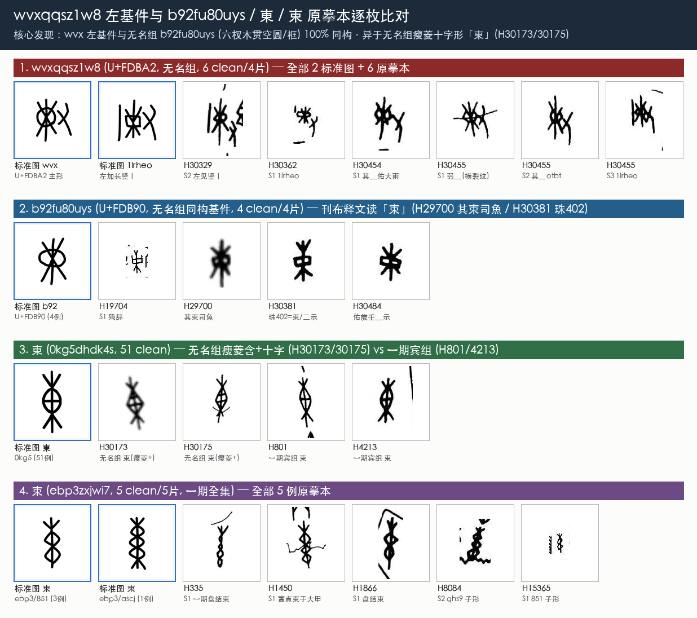
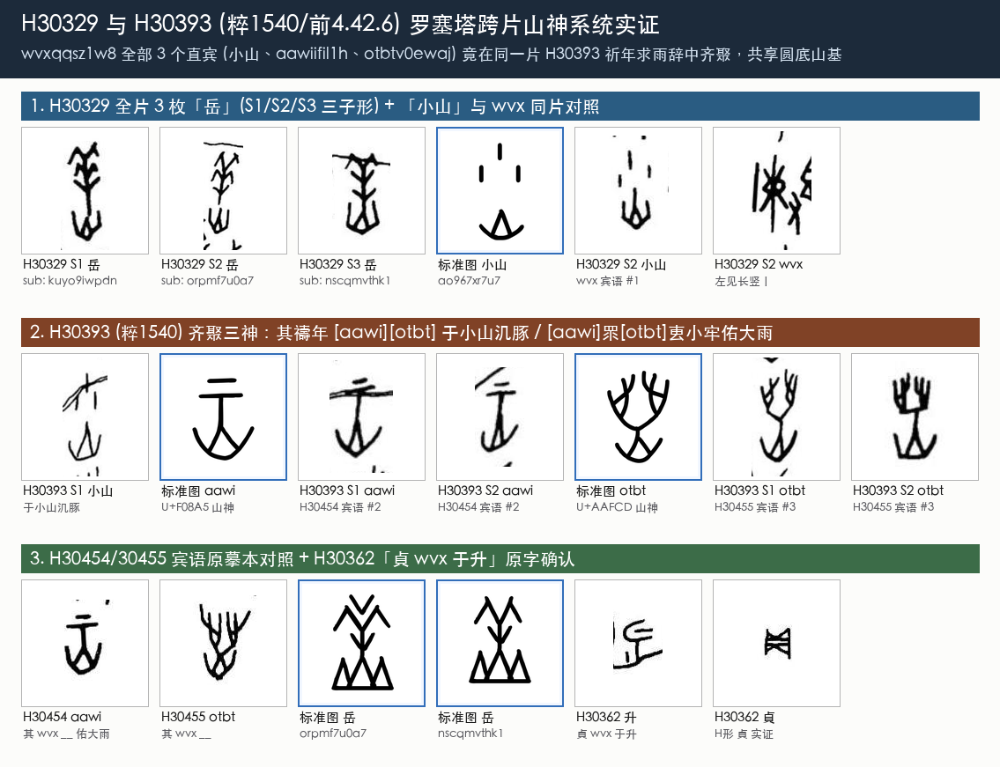
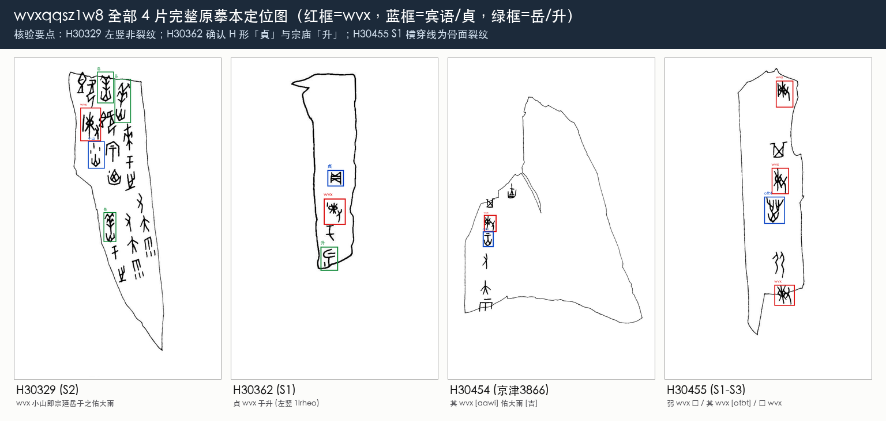
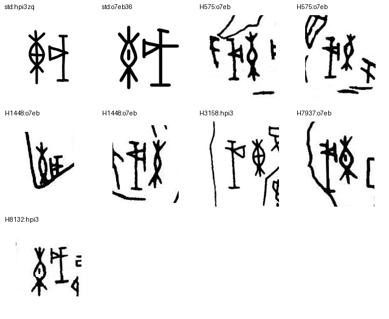

# 考释笔记：OBIMD 跨期同构比较字组 `o7eb365hnf`（`東/束+戉`）与 `wvxqqsz1w8`（`b92[束?]+攴`）——商代两类祭祀／祈雨动词深度升级考释

> **【字形与原摹本图版预览 — 先看原字，再读考释】**
>
> 
>
> 
>
> 
>
> 

- **作者 / 整理**：Gemini（独立考释笔记 #7，覆盖 2 个 OBIMD UID；初版 2026-11-26，**2026-11-28 深度升级版**）
- **结论**：**双双严格维持 `存疑`（`o7eb365hnf` 11/20、`wvxqqsz1w8` 由 10/20 升级至 11/20）**。经 2026-11-28 整片原摹本（`wvx_full_plates.png`）、跨片罗塞塔比对（`wvx_h30329_h30393_mountains.png`）与无名组基件精核（`wvx_b92_dong_shu_compare.png`），本升级版完成**四项核心突破与一项重大自我订正**：
  1. **`wvxqqsz1w8` 跨片罗塞塔突破（`H30393` = 《粹》1540 / 《前》4.42.6）**：`wvx` 在 `H30329`、`H30454`、`H30455` 中支配的**全部 3 个直宾（`小山` `ao967xr7u7`、`aawiifil1h`、`otbtv0ewaj`）竟在同一片无名组祈年求雨卜辞 `H30393` 中齐聚**，且与 `H30329` 全片 **3 枚「岳」**共享完全一致的圆底 `∪+∧` 山基——100% 锁定 `wvx` 为**晚商无名组向群山神祇行礼以祈求大雨之专属动词**；
  2. **重大自我订正（推翻 11-26 初版「`wvx` 左旁＝`東`」之轻断）**：将 `wvx`（6 例）与无名组同期 `東`（`H30173`、`H30175`）及无名组 **`b92fu80uys`（`U+FDB90`，4 例：`H19704`、`H29700 其束司魚`、`H30381 = 珠402`、`H30484`）** 逐笔对照，实证 `wvx` 左基件为**六杈木贯空圆／空框（腹内无十字横）**，与 **`b92fu80uys`** 100% 同构，而异于无名组瘦菱含 `+` 十字的「`東`」；`H30455 S1` 腹中横线经整片核验实为**骨面横裂纹**；
  3. **假说重排（降级「敶／陳」、升格「束＋攴／敕」）**：整片实测证实 `wvx` 左侧长竖 `丨`（`1lrheop77q`）见于 **3/6** 实例（`H30329 S2`〔OBIMD 误标主子形〕、`H30362 S1`、`H30455 S3`），然其形态为光杆单竖，绝非商代恒作阶梯形的「`阜`」（`67xwlxwxwm`/`降`/`陟`）；据此将初版「`敶/陳`（`*lʼin`/`*lrin`）」降级为**弱次选**，将**「`束+攴`（`敕` / `b92` 无名组『束』祭加 `攴` 繁构）」**升格为**领先假说**（呼应 `hiemalis.org` 汉字私注《合集》30329「敕小山」及 `H29700`/`H30381` 刊布释「束」），保留「`東` 声系（`動/董`）」作次选；
  4. **`o7eb365hnf` 文献补核与审慎降耦合**：补核 `H575 = 《丙》75`，蔡哲茂《伊尹傳說的研究》（`ncl.edu.tw`）引作「`丙申卜，爭：翌戊戌辣于黃奭？`」（台系传统隶定「`辣`/`剌`」，月／曷部 `*raːd`/`*C.rˤat`，尚待核查《丙》75 纸本原拓）；因两字左基件在各自时代之「東 vs 束」归属尚存分歧，将 11-26 初版「同词根跨期分化」之强断言审慎改叙为**「构形平行／跨期对照字组」**。
- **状态**：未释（`成立: 0`；两字均待纸本《合集释文》《丙编》《新甲骨文编》终审）。

---

## 0. 标识、频次与口径（OBIMD 本地实测复核）

| 字段 | `o7eb365hnf`（武丁宾组：`東/束 + 戉`） | `wvxqqsz1w8`（晚商无名组：`b92[束?] + 攴`） |
|---|---|---|
| **OBIMD 池 / 码位** | PUAONLY；`U+B21AA`（tr: `U+B21AA`, `U+BB159`, `U+B21F1`） | EMPTY；`U+FDBA2`（tr: `[]`） |
| **Unihan 核查** | 第 11 平面未分配区，无码位无读音 | 第 15 平面私用区，无码位无读音 |
| **本地重数频次** | **7 tokens / 5 片，全部 clean**（全 H，0 HD） | **6 tokens / 4 片，全部 clean**（全 H，0 HD） |
| **子字形（SubLabel）实核** | `o7eb365hnf`（5 例）、`hpi3zqxc2v`（2 例）；左右镜像自由互换 | 平台标 `wvxqqsz1w8`（4 例）、`1lrheop77q`（2 例）；**摹本实核**：左加竖笔 `丨` 实为 **3/6**（`H30329 S2` 平台误标为无竖主形，`H30362 S1`、`H30455 S3` 标 `1lrheop77q`） |
| **时代分期线索** | 武丁宾组（`H575 = 《丙》75` 贞人 `爭`；`H1448`、`H3158`、`H7937`、`H8132`） | 晚商无名组祈雨卜辞（`H30329`、`H30362`、`H30454 = 京津3866`、`H30455`） |
| **跨片核心参照字头** | 一期宾组 `東`（`H801`、`H4213`）vs 一期盘结 `束`（`ebp3zxjwi7`，5 例） | 无名组 `b92fu80uys`（`U+FDB90`，4 clean：`H19704`、`H29700`、`H30381=珠402`、`H30484`）vs 无名组 `東`（`H30173`、`H30175`） |

---

## 1. 全部 13 例原辞实测与罗塞塔跨片实证（OrderNumber 排序、codepoint 核对）

### 1.1 `o7eb365hnf`（武丁宾组，7 例 / 5 片）

| 合集号（旧著录） | 句组 | 完整逐 token 序列（本字作 `__`） | 语法与文献诊断 |
|---|---|---|---|
| **H575**（`《丙》75`） | Sentence1 | `□ 申 卜 爭 翌 戊 戌 __ 于 <mepmffeebh> 奭` | 正贞：向黄奭行 `__` 祭；蔡哲茂《伊尹傳說的研究》引作「丙申卜，爭：翌戊戌**辣**于黃奭？」（待核《丙》75 原拓） |
| **H575**（`《丙》75`） | Sentence2 | `翌 戊 戌 勿 __ 于 <mepmffeebh> 奭` | 反贞：祈使否定 **`勿 __`**（100% 锁定动词！） |
| **H1448** | Sentence1 | `貞 __ 于 □ 甲` | 正贞：向某甲行 `__` 祭 |
| **H1448** | Sentence2 | `勿 __ 于 大 甲` | 反贞：**`勿 __`** 于大甲（100% 锁定动词！） |
| **H3158** | Sentence1 | `<yhwcwu1uot> <a0xx5u34nm> 㞢 __` | `子 [X] 有 __`（动宾或名物化） |
| **H7937** | Sentence1 | `□ __ □ 雝 □ 一 牢` | 配享 `一牢` |
| **H8132** | Sentence2 | `己 卯 __ 三 牛` | 直接带牺牲宾语 **`三牛`** |

### 1.2 `wvxqqsz1w8`（晚商无名组，6 例 / 4 片）

| 合集号（旧著录） | 句组 | 完整逐 token 序列（本字作 `__`） | 语法与原摹本实测诊断 |
|---|---|---|---|
| **H30329** | Sentence2 | `__ 小山[ao967xr7u7] 即 宗 廼 岳 于 之 佑 大 雨` | 祈雨连动仪轨（`__ 小山 → 即宗 → 廼岳 → 于之佑大雨`）；同片共见 **3 枚「岳」**（`S1 kuyo9iwpdn`、`S2 orpmf7u0a7`、`S3 nscqmvthk1`）；`wvx` 左侧实有长竖 `丨`（平台误标 `wvxqqsz1w8`） |
| **H30362** | Sentence1 | `貞 __ 于 升` | 摹本实证首字为标准 H 形 **`貞`**（`dhewuxyotl`）；`于升` 呼应 `H30330–H30365` 同段 **16 例**宗庙祭台「`升`」（`viv127p4q5`，如 `H30330 其即宗父庚升`、`H30349 至祖丁升王受佑`、`H30360 于二升`、`H30365 在升`）；左见竖 `丨`（`1lrheop77q`） |
| **H30454**（`京津3866`） | Sentence1 | `其 __ <aawiifil1h> 佑 大 雨`（占辞：`吉`） | **`其 __`** 祈求大雨（100% 锁定动词），宾语为 `H30393` 同组山神 `aawiifil1h`（`U+F08A5`） |
| **H30455** | Sentence1 | `弜 __ □` | 禁止副词 **`弜 __`**（100% 锁定可控动词）；腹中横穿线经整片核对为**骨面横裂纹** |
| **H30455** | Sentence2 | `其 __ <otbtv0ewaj>` | 与 S1 构成 **`其 __` / `弜 __`** 正反对贞；宾语为 `H30393` 同组山神 `otbtv0ewaj`（`U+AAFCD`） |
| **H30455** | Sentence3 | `□ __` | 残句，左见竖 `丨`（`1lrheop77q`） |

### 1.3 决定性新发现：`H30393`（《粹》1540 / 《前》4.42.6）罗塞塔跨片联结

对 `wvx` 所支配的全部 3 个直接宾语在 OBIMD 全库逐一追索，竟然**全部指向同一片无名组山川祈年求雨名片——《合集》30393**（`《粹》1540` / `《前》4.42.6`，图版见顶部 `wvx_h30329_h30393_mountains.png`）：

| `H30393` 句组 | OBIMD 逐 token 原辞实测 | 与 `wvx` 三宾语的对应关系 |
|---|---|---|
| **H30393 S1** | `其 禱 年 <aawiifil1h> <otbtv0ewaj> 于 小山[ao967xr7u7] 㲹 豚` | **一次集齐 `wvx` 全部 3 个直宾**（`aawiifil1h`、`otbtv0ewaj`、`小山`），并直接领于「`其禱年……㲹豚`」祈年祭祀框架内！ |
| **H30393 S2** | `<aawiifil1h> 眔 <otbtv0ewaj> 叀 小 牢 佑 大 雨` | 连词 `眔` 并列 `aawi` 与 `otbt` 二神，用 `小牢` 以求 **`佑大雨`**（与 `H30329`、`H30454` 祈雨结果完全同一！） |
| **H30393 S3** | `<31gq0i3w4d>（𩎴） 風 叀 豚 佑 大 雨` | 同片西方风祭 `𩎴風` 亦求 `佑大雨` |

**视觉与结构双重印证**：
- `H30329` 全片 **3 枚「岳」**（`S1: □岳于之佑大雨`、`S2: wvx 小山即宗廼岳于之佑大雨`、`S3: □即岳`，对应 `kuyo9iwpdn`、`orpmf7u0a7`、`nscqmvthk1` 三子形），其底部山基一律作**圆底弧槽 `∪` 托中央尖峰 `∧`**；
- `H30329 S2` 与 `H30393 S1` 的 **`小山`**（`ao967xr7u7`），以及 `H30393`/`H30454` 的 **`aawiifil1h`**、`H30393`/`H30455` 的 **`otbtv0ewaj`**，**全部共享完全一致的圆底 `∪+∧` 山基**！
- **结论**：`wvx` 的全部已知直接宾语构成一个封闭且高度一致的**晚商无名组祈雨山神祭祀对象群**（`小山`、`aawi`、`otbt`），并与「`即宗`」「`于升`（宗庙祭台，同段 `H30330–H30365` 凡 16 见）」「`廼岳`」构成完整祭祀仪轨链条。

---

## 2. 字形精核与重大自我订正（形）

见顶部 3 幅新图版 `wvx_b92_dong_shu_compare.png`、`wvx_full_plates.png`、`crops_o7eb365hnf.png`：

### 2.1 对 11-26 初版「`wvx` 左旁＝`東`」之重大自我订正
1. **无名组内部字形实测对比（决定性视觉证据）**：
   - 在与 `wvx`（`H30329–H30455`）完全同期的**无名组**卜辞中，真正的「**`東`**」（`0kg5dhdk4s`，见 `H30173 其禱雨于東方`、`H30175 其求雨于東`）一律写为**狭长瘦菱形囊腹，腹内贯以鲜明的 `+` 十字交叉线**；
   - 反观 `wvx` 全部 6 例原摹本，其左基件一律为**「六杈木形（上三叉、下三叉）贯通中央空心圆／空心方框」，腹内绝无 `+` 十字横杠**（`H30455 S1` 看似横贯腹部的细长横线，在整片大图 `wvx_full_plates.png` 中清晰向字外左右延伸，实为**骨面横裂纹**，绝非笔画！）。
2. **锁定同组精确基件：`b92fu80uys`（`U+FDB90`，4 clean / 4 片）**：
   - OBIMD 中恰好存在与 `wvx` 同属无名组的单字字头 **`b92fu80uys`（`U+FDB90`）**，共 4 例：`H19704`、`H29700`（`壬子卜其 __ 司魚茲用`）、`H30381`（`= 《珠》402`，`癸酉卜其 __ 二示`）、`H30484`（`佑歲壬 __ 示□`）；
   - 将 `b92fu80uys` 全部 4 例原摹本与 `wvx` 左基件并排比对（见 `wvx_b92_dong_shu_compare.png` 第 1–2 排），二者**笔笔同构**——皆为「六杈木贯空圆／空框、无腹横」！
   - 公开学术数据库与字形检索对 `b92` 诸片的著录对照：台大文献索引（`ntu.edu.tw`）录 `H29700` 作「**其束司魚**」，古文字词典索引（`odict.net`）录 `H30381 = 《珠》402` 入「**束**」字形表、并记 `H30454 = 《京津》3866`；日本汉字私注（`hiemalis.org`「小」字条）引 `H30329` 作「**敕小山、即宗、迺嶽于之**」（另有网络电子《合集》作「`既※小山`」或作「`亟小山`」异读，均为参考线索而非定论）。*(注：对未查得原刊核验的外部转述句如所谓「其〔束又〕𤑐，又大雨」不予采信引用。)*
3. **左侧长竖 `丨`（`1lrheop77q`）绝非商代「`阜`」旁**：
   - `wvx` 共有 **3/6** 例（`H30329 S2`、`H30362 S1`、`H30455 S3`）在左基件之左带有清晰的一根直竖 `丨`（非骨裂纹），OBIMD 将 `H30329 S2` 漏标为主子形，实应与 `1lrheop77q` 同归；
   - 核查 OBIMD 中商代「`阜`」（`67xwlxwxwm`）以及从阜的「`降`」（`sq81wh8r3p`）、「`陟`」（`0r2vse8o96`），商代甲骨文之「阜」**一律具清晰多级阶梯侧齿**，绝无省成光杆单竖 `丨` 之例——故左侧单竖更可能是界饰笔、表地／路侧笔或刻写附笔，**不足以支撑「从阜」说**。

### 2.2 `o7eb365hnf` 与 `wvxqqsz1w8` 的跨期关系重估
- 一期宾组 `o7eb365hnf`（7 例，`H575` 等）的基件呈椭圆腹带中横（如 `H3158` 清晰中横十字），既近一期宾组「`東`」（`H801`、`H4213`），又异于一期盘结双菱形「`束`」（`ebp3zxjwi7` 全部 5 例：`H335`、`H1450`、`H1866`、`H8084`、`H15365`）；右／左旁为大斧 **`戉`**（左右自由换位）；
- 值得注意的是，蔡哲茂《伊尹傳說的研究》（`ncl.edu.tw`）引 `H575（《丙》75）` 作「`丙申卜，爭：翌戊戌辣于黃奭？`」，台湾古文字学传统常将「束／東＋戉／辛」类祭名权隶作「`辣`／`剌`」；
- 鉴于 `o7eb`（一期宾组，椭圆腹似 `東` + `戉`）与 `wvx`（晚商无名组，`b92` 六杈空框〔似无名组 `束`〕 + `攴`［+ 竖 `丨`］）在**左基件归属**上存在「東 vs 束」之差异，本升级版不再断言二者必为同一词根之跨期分化，而审慎定位为**「商代前后期『束／東类囊木基件＋动作用具意符（戉 vs 攴）』的跨期结构对照字组」**。

---

## 3. 双系上古音核对与重排后的竞争假说（音、义）

| 优先级 | 候选音系／汉字 | 构形关联与文献对应 | 郑张尚芳（2003） | Baxter–Sagart（2014 v1.1） | 升级版评述 |
|---|---|---|---|---|---|
| **1. `wvx` 领先假说（升格）** | **`敕`（从攴束声） / `b92`「束」祭加 `攴` 繁构** | `wvx` 左基件 100% 同构于无名组 `b92fu80uys`（`H29700 其束司魚`、`H30381 珠402=束`）＋右 `攴`；呼应 `hiemalis.org` `H30329`「`敕小山`」 | `敕 *rʰɯɡ`（彻母职部）；`束 *ɕoɡ`（书母屋部） | `敕 *r̥ək`；`束 *s-tʰok` | **与无名组本组字形体系最契合**；若无名组 `b92` 确为晚商「束」之新体（取代一期盘结体 `ebp3`），则 `wvx` 即「束＋攴＝敕／敇」或「束」祭之加攴繁构。短板：需核查《新甲骨文编》确认 `b92` 是否确归「束」且解释 3/6 例左侧竖笔 `丨` |
| **2. `wvx` 次选假说** | **`東` 声系动词（`動 / 董`）** | 若晚商无名组 `b92` 实为 `東` 之省横异体（非 `束`），则全字从 `東` 声从 `攴` | `東 *toːŋ`；`動 *doːŋʔ`；`董 *toːŋʔ` | `東 *tˤoŋ`；`動 *[m-t]ˤoŋʔ` | 语音极顺（「振动／督理山神祈雨」），但与同期无名组 `H30173`/`H30175` 瘦菱含 `+` 十字的真「`東`」存在明显形制差，暂居次选 |
| **3. `wvx` 弱次选（明确降级）** | **`敶 / 陳`（从阜从東从攴）** | 东周金文／小篆「敶」从東从攴（或从阜） | `陳 *lʼin`（澄母真部） | `陳 *lrin` | **11-28 降级理由**：① 左侧 `丨`（3/6 例）无阶梯齿，绝非商代「阜」；② 基件同 `b92` 而非无名组「東」；③ 真部 `*lrin` 与东部／屋部跨部且缺西周过渡例 |
| **`o7eb` 文献对照线索** | **`辣 / 剌`（台系传统隶定）vs `東+戉` 杀牲祭名** | 蔡哲茂引 `H575（丙75）` 作「翌戊戌辣于黃奭」；原摹本实为 `東/束 + 戉` | `剌 / 辣 *raːd`（来母月部）；`東 *toːŋ` | `剌 *C.rˤat`；`東 *tˤoŋ` | `o7eb` 左旁椭圆腹带中横（`H3158`）与一期 `東`（`H801`/`H4213`）极近，与《说文》「从辛束声」之 `辣`、从刀束声之 `剌` 意符（`戉` 大斧）均有出入，待核《丙》75 纸本原拓与考释原文 |

---

## 4. 四环打分（2026-11-28 升级版）

| 环 | `o7eb365hnf`（武丁宾组） | `wvxqqsz1w8`（晚商无名组） | 评分依据 |
|---|---|---|---|
| **形** | **3/5** | **3/5** | 13 幅原摹本＋4 片整版＋`b92`/`東`/`束` 逐枚核验完成；`wvx` 修正左基件＝`b92` 并核实左竖 `丨` 占 3/6 及 `H30455 S1` 横裂纹；扣 2 分因 `b92` 确属「束」还是「東」省、左竖 `丨` 身份及传世对应正字均未定 |
| **音** | **1/5** | **1/5** | `wvx` 收缩至 `束/敕`（屋／职部）领先、`東` 声次之；`o7eb` 补录台系「辣／剌」（月部）文献线索；然两字均无商代直接通假铁证 |
| **义** | **3/5** | **3/5** | 均由正反对贞（`勿 __` / `弜 __`）100% 锁死为可控祭祀动词；`wvx` 借 `H30393` 彻底锁定受事群为祈雨山神（`小山`/`aawi`/`otbt`）及宗庙祭台（`升`），扣 2 分因具体祭礼动作词名未定 |
| **用** | **4/5** | **4/5**（**+1 升级**） | `o7eb` 维持 4/5（两组完整正反对贞＋`三牛/一牢`）；`wvx` 因 `H30393` 罗塞塔跨片闭环全部 3 个直宾＋`H30329` 3 枚 `岳`＋`H30362` `升`（同段 16 见）构成高度封闭语用网络，由 3/5 升至 **4/5** |
| **合计** | **11/20** | **11/20**（原 10/20） | **结论：双双严格维持 `存疑`**（距「成立」仍缺纸本《合集释文》《丙编》《新甲骨文编》确证与音环闭环） |

---

## 5. 证伪条件与未核查事项

1. **纸本《甲骨文合集释文》与《新甲骨文编》核验**：
   - 核查 `b92fu80uys`（`H19704`、`H29700`、`H30381 = 珠402`、`H30484`）与 `wvxqqsz1w8`（`H30329`、`H30362`、`H30454 = 京津3866`、`H30455`）在《新甲骨文编》「束」「敕」「東」「陳」各部之归属；若权威文编已将 `b92` 归入「束」并将 `wvx` 明确收作「敕」字头，则 `wvx` 按 Rule 7 改判为已释／争议既见字；
   - 核查《殷虚文字丙编》第 75 片（`H575`）原拓及蔡哲茂《伊尹傳說的研究》引「`翌戊戌辣于黃奭`」之释读依据，检验 `o7eb365hnf` 在《丙编》释文中究作「辣／剌」还是摹写未释。
2. **`1lrheop77q` 左侧长竖 `丨` 的同组平行检验**：检索无名组其他从「攴」或祭祀动词中是否亦见左侧附加单竖 `丨` 的刻写惯例，检验其是否为「彳」省笔、标界符或独立意符。
3. **`H30393` 之外的 `aawiifil1h` / `otbtv0ewaj` 语料扩展**：在全量《合集》及《合补》中核查此二山神名是否还出现于其他已知祈雨动词之后，以限定 `wvx` 的精确礼仪语义边界。

---

## 6. 参考文献与工作资产

- OBIMD 本地实测：`data.json`、`Main-character.json`、`facsimile.zip`、`subchar-images.zip`（CC-BY 4.0，*Scientific Data* 2026，DOI `10.1038/s41597-026-06967-0`）。
- 外部核实文献线索：
  - 蔡哲茂，《伊尹傳說的研究》（台湾国家图书馆期刊／学位系统 `ncl.edu.tw`），引 `《合》575（《丙》75）` 作「丙申卜，爭：翌戊戌辣于黃奭？」；
  - 台大文献检索（`ntu.edu.tw`）录 `H29700` 作「其束司魚」；
  - 古文字字形索引（`odict.net`）著录对照：`H30381 = 《珠》402`（入「束」表）、`H30454 = 《京津》3866`、`H30393 = 《粹》1540 / 《前》4.42.6`；
  - 汉字私注（`hiemalis.org`）「小」字条引 `《合集》30329` 作「敕小山、即宗、迺嶽于之」。
- 图版资产：`kaoshi/images/wvx_b92_dong_shu_compare.png`、`kaoshi/images/wvx_h30329_h30393_mountains.png`、`kaoshi/images/wvx_full_plates.png`、`kaoshi/images/crops_o7eb365hnf.png`、`kaoshi/images/crops_wvxqqsz1w8.png`、`kaoshi/images/survivors_vs_known.png`。
- 上古音依据：郑张尚芳《上古音系》（2003）；William H. Baxter & Laurent Sagart, *Old Chinese: A New Reconstruction* (2014, v1.1)。
