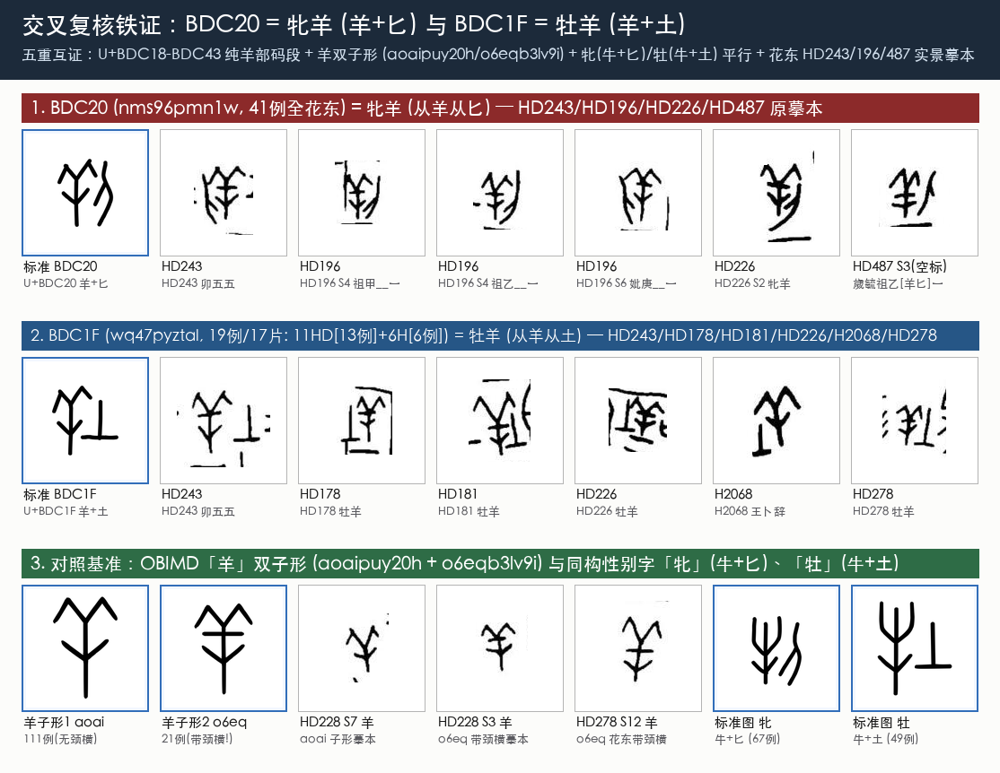

# 考释笔记：U+BDC20 / U+BDC1F（花园庄东地歲祭中的两个未释祭品字）

**日期：** 2026-11-26
**状态：** 考释完成，结论先行
**结论：BDC20 存疑；BDC1F 存疑（弱于 BDC20）。两个字均无读法提出，均不是新字破解。**

## 0. 标识与口径

- **BDC20** = OBIMD UID `nms96pmn1w`，码点 U+BDC20，transcription 仅为 `[\U000bdc20]`（PUA 私用区码，无今字对应）。OBIMD `Main-character.json` 中仅 1 个标准字形；子字分解：自身 + 子 UID `66js7x9h0l`（subchar-images.zip 中该子字文件夹为空，无图）。
- **BDC1F** = OBIMD UID `wq47pyztal`，码点 U+BDC1F，transcription 仅为 `[\U000bdc1f]`。标准字形 1 个；子字分解：自身 + 子 UID `omzh07bi91`（同样空文件夹，无图）。
- **数据来源：** OBIMD 语料库（*Scientific Data* 2026，DOI 10.1038/s41597-026-06967-0；Hugging Face `KLOBIP/OBIMD`，CC-BY 4.0；`data.json` 10,077 条记录，115,319 字符 token，1,731 个 distinct labels）。工作目录 `~/workspace/oracle-screening/obimd/`。
- **方法：** 全部用例均由 `data.json` 本地重数（按 UID，不按首选转写字符计数）；标准字形来自 `subchar-images.zip`，摹本来自 `facsimile.zip`，逐例看图比对。邻近字同样按 OBIMD UID 直接调图比较，不依赖记忆中的字形。
- **关键订正（对任务书和 fi 笔记的数字）：** 任务书所称 "14 tokens"（BDC20）与 "5 tokens"（BDC1F）经重数**属实，但只是花园庄东地 "歲 + 先祖名 + __ + 一" 祭祀槽位内的计数，不是全库计数**。全库重数结果是：**BDC20 共 41 tokens / 25 片 / 40 句组；BDC1F 共 19 tokens / 17 片 / 19 句组**。下文凡称 "14 例""5 例"均指槽位内计数。
- **合集号：** 本笔记**未查到**两字任何一例的合集号。HD 编号为花园庄东地坑号（HD = Huayuanzhuang East），不是合集号；H 编号为《合集》编号的 OBIMD 简写（如 H784），但 OBIMD 未给出与《合集释文》的对应，引文时只写 H 编号，不写 "合集 H784" 之类未经核实的对应。
- **未做的工作（诚实记录）：** 未查《新甲骨文编》纸本（两字及麥、來、牡、牝等条目的字形表）；未查《殷墟花园庄东地甲骨》（2003）出版释文及 Schwartz 2019 英译；未查《类纂》"歲 + 先祖 + 祭品"类；未做 HUST-OBC 图像侧近邻匹配（此前 X/1850 工作已证实像素余弦近邻法的区分力不足，见 `screening-nn-match.py`）；未查《甲骨文字综理表》。

## 1. 用例与出处（全部由 data.json 重数）

### 1.1 BDC20：41 tokens / 25 片 / 40 句组，全为花园庄东地（HD），0 H

- 全部 Mark −1，SeatFont 0（即全部为字形库内无今字对应的未释字）。
- 片号（HD + 出现次数）：HD139, HD196 (3), HD226 (3), HD228, HD240 (3), HD241 (2), HD243, HD252 (3), HD264, HD267 (3), HD270 (2), HD288, HD289 (2), HD34, HD353, HD363, HD39 (2), HD409, HD413, HD421 (2), HD449, HD463 (2), HD481, HD490, HD493。HD196 一句含两个 BDC20（"己酉歲祖甲【BDC20】一歲祖乙【BDC20】一入自𠯑"，两歲並列），故句组 40 < tokens 41。
- **后接字（下一 token，n=41）：** 一（UID jrzjjh3g1r）32 例（78%）；妣庚 4；不 1；五 1；祖乙 1；祐 1；1 例后接字形无法辨认（Label 为空）。
- **前接字（上一 token，n=41）：** 宜（UID f0j9ho8ua2，transcription `[\U000a88a1, '宜']`）8；妣庚 6；祖甲 3；祖乙 3；又/有/侑/佑/祐（UID c40r3zyq5t）3；友 3；子 3；妣丁 2；叀/惠 2；害异体 1；3 例前接字无法辨认（Label 为空，HD363/HD409/HD413，均为残片）。
- **句内共现（n=40 句组）：** 含 歲 23 句组；含 祭 3；含 卯 2；含 祝 6；含 鬯 4。
- **槽位计数（复核 fi 笔记 §9 所指的槽位）：** 花园庄东地 "歲 + 先祖名 + BDC20 + 一" = **14 例**，与 fi 笔记数字一致。先祖名集合：祖甲/祖乙/妣庚/妣甲/妣丁/妣己/匕庚/匕己。
- 全部 41 例的释文清单见 `sent_nms96pmn1w.txt`（工作目录）。

### 1.2 BDC1F：19 tokens / 17 片 / 19 句组，11 HD + 6 H

- 全部 Mark −1，SeatFont 0。
- 片号：H784, H1951, H2068, H23539, H26021, H32318, HD178, HD181, HD226, HD237, HD243, HD278, HD354, HD374, HD455, HD463 (2), HD493 (2)。
- **后接字（n=19）：** 一 7；句末 3；无法辨认 2；𰇑 1；十 1；于 1；𠯑 1；五 1；𫹉 1；子 1。
- **前接字（n=19）：** 无法辨认 4；妣庚 3；一 2；二 1；句首 1；㘡 1；气 1；毓祖乙 1；祖乙 1；卯 1；豕 1；小 1；妣甲 1。
- **句内共现（n=19）：** 含 歲 9 句组；含 卯 1；含 祝 2；含 鬯 1。
- **槽位计数：** 花园庄东地 "歲 + 先祖名 + BDC1F + 一" = **5 例**，与 fi 笔记数字一致。
- 全部 19 例释文清单见 `sent_wq47pyztal.txt`（工作目录）。
- **分布不对称：** BDC20 全部出自花园庄东地子卜辞；BDC1F 除 11 例 HD 外另有 6 例 H（王卜辞），但 6 例 H 几乎全是残句（H1951、H2068、H23539、H26021、H32318 均为断句，H784 句 "午于高匕己衁二𰇑𠬝垂" 语义不明）。BDC1F 的证据质量因此弱于 BDC20。

### 1.3 决定性共现：HD243 一句之内两字並列，各数五

HD243 InscriptionSentence1（全文，OBIMD 原文，方括号内为本笔记加注）：

> 乙亥月𫹉伐一于祖乙卯五五祝鬯子肩午往

即在卯祭中，**五 BDC1F、五 BDC20** 並列献祭。这是全库唯一一句同时含两字的句组（两字同片共现另有 HD226、HD463、HD493，均为不同句）。**结论：BDC20 与 BDC1F 是两个不同的词，不是同一字的异写。** 两字共享左部件（见 §2），故可能是一对同基字（同左部件 + 不同右部件），也可能只是碰巧共用部件；不合并。

### 1.4 与已知祭品同列——两字都不是已知祭品的异写

- **BDC20 与 牡 同列：** HD463 "甲辰歲祖甲牡一一才𠯑"；HD252 "乙亥歲祖乙㛸牡一又一㿝子祝"（㛸、牡、BDC20 三项並列）。
- **BDC20 与 豕 同列：** HD34 "戊申卜歲祖甲豕一一"。
- **BDC20 与 㛸 同列：** HD252（见上）。
- **BDC1F 与 牡 同列：** HD463 "甲辰歲祖甲牡一一才𠯑"（与 BDC20 的 HD463 例为同片不同句）。
- 因此：**BDC20 ≠ 牡、≠ 豕、≠ 㛸；BDC1F ≠ 牡**（至少在这些献祭清单中，它们是与已知祭品並列的独立项）。

### 1.5 槽位总表（花园庄东地 "歲 + 先祖名 + X" 槽位内计数，本次重数）

先祖名集合同 §1.1。**BDC20 14，牢 13，㛸 13，用 10，牡 9，小 8，牝 8，豭 7，fi0wiw1adi 7，小𫳅 5，白 5，BDC1F 5，彖 5，廌 3，䝅 3，豕 3，羊 1，豖 1**，另有单例若干（㲹、永、二、示、先、翼、祐、于、歲、雨、三、U+BDC40、U+BB59B、U+C4D4A 各 1）。BDC20 是该槽位内**频率最高的未释字**（14 例），高于 fi0wiw1adi（7 例）。

**与 fi 笔记 §4.1 的微小出入（记录在案，不静默覆盖）：** fi 笔记的表为小 7、彖 4，且未列 fi 本身。本次重数为小 8、彖 5，且 fi 本身 7。差异最可能来自先祖名集合（本次含匕庚/匕己）与合文字（如 "小𫳅""一牢""一豭"）的计法不同。fi 笔记的原表保留，两表差异不影响任何结论。

### 1.6 "宜" 的位置（未定，不作证据）

- 宜（f0j9ho8ua2，全库 115 tokens：52 HD / 63 H）后接统计：句末 21，□ 13，于 9，叀 8，**BDC20 8**，牢 6，丁 4，羌 2，大 2，一 2，一牢 2，至 2，牝 2。BDC20 在宜后出现的次数（8）与牢（6）相当，即 BDC20 在宜后处于与牢相同的祭品名词类。
- 但 **宜本身的读法未定**：或为祭祀动词（"宜于祖先"），或为 "适宜" 之义。本次检索 "甲骨文 宜 祭祀 动词 宜于祖先 卜辞" 未得到直接判定；五周祭（彡/翌/祭/𢀜/脅）中并无宜（Lim 2005；KCI 五种祭祀论文）。**宜的词性不定，故不以宜后位置论证 BDC20 的物种。**

## 2. 字形分析（标准字形 + 摹本逐例看图）

标准字形图：`images/std_nms96pmn1w.png`（BDC20）、`images/std_wq47pyztal.png`（BDC1F）。摹本拼图：`images/crop_bdc20_all.png`（41 例）、`images/crop_bdc1f_all.png`（19 例）。

### 2.1 两字共享的左部件

两字左部相同：**顶部为 M 形（双峰），中部为 V 形分叉，下部为一根单茎，末端收尖**。植物状，无头、无角、无耳、无足、无尾、无口——无任何动物部件。41 例 BDC20 摹本中左部形态稳定，变异仅在笔画粗细与峰的开合；19 例 BDC1F 摹本亦然。

### 2.2 右部件：两字之别

- **BDC20 右部：** 一根高竖笔，中部向左下方分出一斜枝，底部微曲；摹本中在 "纯高竖" 与 "竖 + 斜枝" 之间摇摆，属同一部件的省笔/繁笔之别。
- **BDC1F 右部：** 一竖立于一横之上（⊥ 形），与 OBIMD 中 土 的异体**完全一致**；与 上 的 OBIMD 异体（∪ 形加横、及二字形）**不符**。故 BDC1F 右部定为 土，置信度高。
- **子字分解不可用：** OBIMD 给两字各配一个子 UID（BDC20：66js7x9h0l；BDC1F：omzh07bi91），但 `subchar-images.zip` 中这两个子字文件夹**均为空**，孤立部件图未随库发布，无法单独看图。对比：來 有 4 个子 UID，牢 4 个，黍 8 个，麥 2 个，羊 2 个，豕 3 个；fi0wiw1adi 仅自身。

### 2.3 摹本变异

BDC20 的 41 例摹本：左部 M 形稳定；右部竖笔高度与斜枝有无有变异，无一例出现第二横或第二竖。BDC1F 的 19 例摹本：左部与 BDC20 同形；右部 ⊥ 形稳定，横的长度略有变化。**两字在各自的全部用例中无向其他已知字过渡的中间形**（与 X/1850 在 由 的两极之间连续过渡不同）。

## 3. 音（无）

- 两字均无可辨认的声符：左部为象形部件，右部（竖+斜枝 / 土）为意符类部件，均非声符。
- 无青铜/金文后代字形，无《说文》收字，无通假例证。
- **音环 0/5。** 任何读法都无法从音上立论。

## 4. 义与句法检验

### 4.1 可数祭品名词——成立

- BDC20 后接 一 32/41（78%），BDC1F 后接 一 7/19；HD243 例中各数五（"卯五五"）。
- 位置：歲祭句中 "歲 + 先祖名 + __ + 一"（BDC20 14 例、BDC1F 5 例）；卯祭句中 "卯 + __ + 五"（HD243）；宜后（BDC20 8 例，与牢 6 例同类）。
- 与 牡/豕/㛸/牢 並列于同一献祭清单（§1.4），且为独立项。
- **结论：两字都是可数祭品名词，语法地位与牢/牡/牝/豭/豕/羊相同。**

### 4.2 排除

- **不是人名/地名/族名：** 从不出现在人名槽（"令 __ 取/省/以"、"才/于/往 + __" 等，参 cdd4p6xm9e、2lep30tiiz、tq26tb9tj9 的排除理由）；从不作主语（cdd4p6xm9e 的 "歲/伐 + __" 主语槽不在此列——BDC20/BDC1F 出现在 歲 之后、数词之前，是宾语性祭品位）。
- **不是动词：** 从不在动词位；无 "王 __ 叀父戊" 式动词槽（⟨礻+升⟩ 的槽）。
- **不是虚词/连词：** 位置固定于祭品序列内，后接数词；与 ff8rp0nhz6u（40 tokens，动词/连词类，字形不稳）不同。
- **不是器物名（弱排除）：** 字形无任何器皿部件（无口、无足、无耳、无盖），与 尊/爵/彝/鬯/㿝/匁 均不像；但祭品名词本就不限于动物，谷物亦可，故器物说不能完全排除，仅列为弱可能。

### 4.3 卯祭平行句（支持 "祭品 + 数词" 读法）

中央研究院历史语言研究所藏 "己丑侑上甲一伐卯十小羊"（《合集》11497 / 《丙编》207）：卯后接 "十" + 动物。结构 "卯 + 数词 + 祭品" 与 HD243 "卯五五" 完全平行——卯为祭名（晨祭），其后为祭品及其数量。**HD243 的结构因此不是孤例。**（此平行句为王卜辞，与花园庄东地子卜辞分属不同卜辞群，平行力度为 "结构同"，非 "同文"。）

### 4.4 物种/种类：未定——与 fi0wiw1adi 相同的张力

- 槽位（歲/卯祭品）以动物为主（牢/牡/牝/豭/豕/羊/彖/廌/䝅），但也有非动物项：白（5 例，色词作祭品修饰，参 fi 笔记）、用（10 例）、小（8 例）。
- 字形（植物状左部）与动物槽位冲突，与 fi0wiw1adi（无动物部件 + 祭品槽）完全相同。
- **白 后的启示（fi 笔记已论证，此处重申）：** "白" 后可接白圭（玉）、白屯，证明 "白 + X" 只说明 X 是 "可着色/可修饰的祭品名词"，不能证明 X 是动物。BDC20/BDC1F 均未见白后例，故无此线索。
- **分布窄：** BDC20 全部出自花园庄东地子卜辞，0 例王卜辞；BDC1F 6 例 H 均为残句。OBIMD 只覆盖《合集》的一部分，故 "王卜辞中缺席" 是弱证据，不能据此断言两字只用于子卜辞。

## 5. 邻近字逐一排除（全部由 OBIMD 标准字形与摹本直接比对）

### 5.1 动物字（槽位内的主要邻近字）

| 字 | UID / 用例 | 排除理由 |
|---|---|---|
| **牛** | 66iowpdbuc，97 变体，526 tokens（58 HD / 468 H） | 97 变体**全部**为 Ψ/U 形——两根分离的竖角、竖直躯干、V 形（腿）在**底部**，V 下无物。BDC 左部 V 在**中部**，其下有一根长单茎。**系统性差异，左部 ≠ 牛。**（拼图 `images/nb_niu_all.png`） |
| **牡** | h204u5h9ms，1 标准图，49 tokens（32 HD / 17 H） | 标准形为 Ψ 形动物 + 右部 ⊥，结构上与 BDC1F 最接近。但 HD 摹本（HD124、HD139、HD150、HD161、HD180、HD181、HD198、HD223）显示**两根分离的竖角（Ψ）**，而 BDC1F 19 例一律为连笔 M 顶；且 HD463 中牡与 BDC1F 並列为独立项。**BDC1F ≠ 牡（字形上），但为最接近的结构平行。**（拼图 `images/crop_mu_hd.png`） |
| **牝** | nllrzldww6，66 变体，67 tokens（45 HD / 22 H） | Ψ 形动物 + 右部曲刃形 匕（HD115、HD132、HD161、HD175、HD178、HD180 摹本）；BDC20 右部为高竖 + 斜枝，非短曲刃。**≠。**（拼图 `images/nb_pin_all.png`、`images/crop_pin_hd.png`） |
| **豕 / 豭** | 豕 112 tokens，豭 43 tokens | 均有头/耳/足/尾；BDC 两字无。**≠。** |
| **羊** | aoaipuy20h，2 变体，133 tokens | M 顶但**中部恒有一横**；BDC 左部无横。**≠。** |
| **黍** | 6 变体，63 tokens | 有谷粒点，结构更复杂。**≠。** |
| **鹿 / 馬 / 兔 / 虎 / 象 / 彖 / 廌 / 䝅 / 豖 / 犬** | 各有 UID | 均有头/角/足/尾等动物部件；BDC 两字无。**≠。** |

### 5.2 植物字（字形上的主要邻近字）

| 字 | UID / 用例 | 排除理由 |
|---|---|---|
| **來** | rlx0knkq0v，70 变体，346 tokens | M 顶常见，但**底部恒分两足/两根**；BDC 左部底部为**单茎收尖**，41 例无一分叉。左部比牛更接近來，但 **≠ 來**。左部与 來 的关系是本笔记的核心未决问题（见 §6 读法 A）。（拼图 `images/nb_lai_all.png`） |
| **禾** | om61e8d11r，1 变体，127 tokens | 单叉（∧）顶，非 M 形。**≠。** |
| **麥** | zxuw992m8p，2 变体，仅 3 tokens（H8195、H24404、HD475） | 字形更高、多层分枝，与 BDC20 摹本明显不同（拼图 `images/crop_mai.png`）；分布亦不同：3 例均不在歲祭槽，语境为移动/处所（"鼎商至于"、"于往來亡川才六月"、"……令子曰往眔帚好于𭆲子……"）。**BDC20 ≠ OBIMD 的麥（字形与分布双重不符）。**但 麥 = 來 + 夊 的构字关系使 麥 仍为 BDC20 的首要竞争读法（见 §6 A），只是未证实。 |
| **秉** | 1g215frscw，1 变体，全库仅 1 token（H519 "□𠭁四羌才十二月"，残句） | 标准形为植物 + 右部 X 形（交叉）部件；BDC20 右部为高竖 + 斜枝，非 X 形。**≠。** |
| **芻 / 束 / 穗 / 秋** | 芻 2 变体，束 3 变体，穗 2 tokens，秋 3 tokens | 形皆不同。**≠。** |
| **稻 / 秫 / 稷 / 秬 / 秠 / 秣 / 秸 / 秝 / 麰 / 麳 / 羔 / 特 / 牯 / 牴 / 牣 / 羝 / 牂** | OBIMD `Main-character.json` 中无 UID | 本库无法比对；其中 羔（羔羊）在槽位上相关，但无字形可比。**未比对，记录在案。** |
| **牽** | cw5ibl90cs，UID 存在但 0 tokens | 无摹本可比。**未比对。** |
| **止 / 人 / 夊 / 攴 / 殳** | 止 ch3eogm319（20 tokens），人 p6uj3n0aze（42 变体，181 tokens）；夊/攴/殳无 UID | 止、人标准形与 BDC 右部/左部均不符；夊/攴/殳无 UID，无法比对。**BDC20 右部与 止/夊 型笔画的相容性未验证**（见 §6 A 与 §10）。 |

### 5.3 其他

- **尊 / 爵 / 彝 / 鬯 / 㿝 / 匁 / 戈 / 矢 / 木**：均无相似部件。**≠。**
- **牢**（681 tokens，53 HD / 628 H）：牛 + 宀（圈栏），字形与 BDC 两字完全不同；但槽位上牢是 BDC20 的最近邻（歲祭槽 13 例，宜后 6 例）。**字形 ≠，槽位同类。**
- **白**：色词，非字形邻近字；见 §4.4。
- **𫹉**（hclsl73wg4，453 tokens，PUA 读法）：HD243 句中 "乙亥月𫹉伐一于祖乙……" 的 𫹉 为动词/人名类，与 BDC 两字无字形关系。**≠。**

## 6. 竞争性读法（均未证实，按可信度排序）

### 读法 A（BDC20 首选假说）：穀物类祭品，麥 为最近的已知词

- **主张：** BDC20 是一穀物（麥/黍类）祭品；最接近的已知词是 麥。
- **支持：** (1) 左部植物状，M 顶与 來 的 M 顶同类，而 來 是麥的本字（《說文》"麥，从來，有穗者；从夊"；CUHK《漢語多功能字庫》：甲金文从夊，來声；來象麥子之形，是麥的本字）；(2) 麥在甲骨文中有 "食麥" 之例（《合集》24440，据 CUHK），是真实存在的甲骨文穀物词；(3) 歲祭槽位中非动物祭品并非没有先例（用、小、白）；(4) BDC20 右部（高竖 + 斜枝）与 夊/止型笔画在原则上相容（夊为倒止，象足形）。
- **反对（决定性弱点）：** (1) OBIMD 的 麥 3 例与 BDC20 摹本**字形明显不同**（更高、多层分枝），且**从不在歲祭槽**，语境为移动/处所（"至于麥""于麥往來"），其中至少两例更像地名而非穀物；(2) 來 的 70 变体底部恒分两足，BDC20 左部单茎收尖——若 BDC20 = 來 + 夊，则左部应与 來 同形，实际不符；(3) 夊在 OBIMD 中无 UID，右部与夊的相容性**未做摹本比对**；(4) 若 BDC20 = 麥，则《新甲骨文编》应有同形条目与之合并——未查（见 §10）。
- **结论：** 麥假说**未证实**。它是目前唯一有文献构字链支撑的假说，但字形与分布两项证据均不利。**不读作麥。**

### 读法 B（BDC1F 首选假说，BDC20 次选）：性別/种类分化的牛，牡/牝 的平行字

- **主张：** BDC1F（左部植物状 + 土）与 BDC20（左部植物状 + 竖斜）是一对与 牡（牛 + 土）、牝（牛 + 匕）平行的牛类分化字，即某种牛以左部 + 右部标志性别或种类。
- **支持：** (1) 牡的标准形（Ψ 动物 + ⊥）与 BDC1F（M 顶植物 + ⊥）在结构上几乎一一对应，右部同为 土；(2) 槽位完全一致（歲祭祭品，牡 9 例、BDC1F 5 例、BDC20 14 例同槽）；(3) HD243 "卯五五" 与 "卯十小羊" 的平行结构（§4.3）说明两字是与羊同类的献祭动物/祭品。
- **反对（决定性弱点）：** **左部 ≠ 牛**——97 个牛变体无一 M 顶（§5.1）。牡/牝的 HD 摹本均显示 Ψ 形双角，BDC 两字 60 例摹本无一 Ψ 形。平行字的前提（左部 = 牛）不成立。
- **结论：** 结构平行引人注目，但左部证据否决。**不读作牛类。** 唯一的挽救方式是证明左部是牛的某种省笔异写——60 例摹本中无一过渡形，此路极难。

### 读法 C：未并入的已知字异体（X/1850 式）

- **主张：** BDC20 / BDC1F 是某已知字的异写，因《新甲骨文编》编纂时未并入而以 PUA 码独立存在（X/1850 = 由 的未并入异体即为先例）。
- **支持：** X/1850 的教训（61 例、X 源独有、与 由 的两极变异连续）；BDC20 全部 HD、41 例集中于花园庄东地，与《新甲骨文编》X 源的分布特征相似。
- **反对：** (1) X/1850 有与 由 逐例比对的连续过渡形；BDC 两字经 30+ 邻近字逐一比对，**无一已知字与之连续过渡**（§5）；(2) BDC20 与 牡/豕/㛸 同列为独立项（§1.4），若为已知字异体，应与该已知字互斥出现，而非同列。
- **结论：** 不能排除，但无正面证据。**检验方法在 §10（《新甲骨文编》按字形检索）。**

### 读法 D：器物/礼器名

- **主张：** BDC1F（+ 土）或 BDC20 为某种礼器。
- **反对：** 字形无任何器皿部件；歲祭槽位内器物项极少；"卯五五" 的 "五" 计数更适合动物/穀物而非礼器（礼器通常不以五计数献祭）。
- **结论：** 弱可能，**不采纳**。

### 读法 E：BDC20 与 BDC1F 为同一词的两体

- **已否决：** HD243 一句之內两字並列、各数五（§1.3）。同一词的两体不会在同一献祭清单中分列计数。**BDC20 ≠ BDC1F。**

### 读法 F（fi 笔记的类比）：fi0wiw1adi 式 "白色祭品" 读法

- fi0wiw1adi 的首选假说是白色祭祀动物（种未定），依据是 "白" 两次先行。BDC20/BDC1F **无白后例**，无此线索。**不适用。**

## 7. 历时链

- **麥链（读法 A 的链）：** 來（象麥子之形，本字）→ 麥（來 + 夊，《說文》"从來，有穗者；从夊"；CUHK：甲金文从夊，來声）→ 小篆麥 → 今麥。**BDC20 不在该链上**：左部与 來 不符（单茎 vs 双足），右部与 夊 未比对。
- **土链（BDC1F 右部）：** 土在甲骨文中有 ⊥ 形异体，BDC1F 右部与之完全一致。但土为意符，**不能单独定音定义**；牡（牛 + 土）证明 "X + 土" 可构成祭品名词，但 X 须为动物——BDC1F 的左部不是牛。
- **BDC20 右部：** 无后代字形，无《说文》收字，无金文平行。
- **结论：** 两字均无可验证的历时链。

## 8. 证据链打分（形、音、义、用，各 0–5 分，依 report.md §5 的标准）

| 环 | BDC20 | BDC1F | 说明 |
|---|---|---|---|
| **形** | 2 | 2 | 字形描述清楚（左 M 顶 + V + 单茎；右竖斜 / 土），30+ 邻近字已排除；但左部归属未定（來？牛？），右部与夊未比对 |
| **音** | 0 | 0 | 无声符，无通假，无后代字 |
| **义** | 3 | 2 | 可数祭品名词成立（BDC20 41 例、槽位固定、同列证据强；BDC1F 19 例、6 例 H 为残句，弱一档）；物种/种类未定 |
| **用** | 4 | 2 | BDC20：41 例 / 25 片 / 40 句组，全 HD，歲/卯祭固定槽，后接一 78%；BDC1F：19 例 / 17 片，分布较散，残句多 |

- **BDC20 总评：** 形 2、音 0、义 3、用 4。**存疑**——祭品名词的语法地位可信，物种与读法全无。
- **BDC1F 总评：** 形 2、音 0、义 2、用 2。**存疑（弱）**——与 BDC20 同槽、不同词可信，其余未定。
- **均不构成 "成立"**（成立须四环互证，至少音或历时链有一项过关）。

## 9. 证伪条件（任一成立即推翻或改判本笔记结论）

1. 《新甲骨文编》或《甲骨文字综理表》中查到与 BDC20 / BDC1F 同形的已释字条目 → 两字为该字的未并入异体（读法 C 成立，本笔记 "未释" 结论作废）。
2. 《殷墟花园庄东地甲骨》出版释文或 Schwartz 2019 英译对 HD243、HD463、HD252、HD34 任一片给出今字读法 → 按出版释文改判。
3. 发现 BDC20 的王卜辞（H）用例且其后接字与 HD 用例矛盾（如作动词）→ "祭品名词" 结论动摇。
4. 发现左部 M 顶 + V + 单茎的牛异体（Ψ 形与 M 形之间的过渡形）→ 读法 B 复活。
5. 发现 BDC20 右部与夊/止的摹本级同形证据且 來 的单茎异体存在 → 读法 A（麥）大幅增强。
6. 发现两字中任一字的第二句 HD243 以外的並列句（如 "三三"）→ 两字不同词的结论加强；反之若发现两字互换于同一槽位（如同一句型中 BDC20 与 BDC1F 自由替换）→ "不同词" 结论需重审。

## 10. 下一步（按优先级）

1. **图书馆查《新甲骨文编》**（刘钊主编，2014）：按字形检索 BDC20 / BDC1F（左部 M 顶 + V + 单茎），核对是否有同形已释条目；同时核对麥、來、牡、牝条目的异体表。这是证伪条件 1 的直接检验，也是本笔记最大的未竟项。
2. **图书馆查《殷墟花园庄东地甲骨》（2003）**：核对 HD243、HD463、HD252、HD34、HD241、HD267 等片的出版释文与考释，看出版者是否给出读法；同时核对 Schwartz 2019 英译。
3. **查《类纂》"歲 + 先祖 + 祭品"类**：核对歲祭祭品清单中是否有与 BDC 两字同槽的未释字已列入类纂，以及 fi0wiw1adi、U+BDC40、U+BB59B、U+C4D4A 等同槽 PUA 字是否同属一类。
4. **查《甲骨文字综理表》（2024，ISBN 9787547523407）**：2,112 个未释字头条目，按字形检索 BDC20 / BDC1F 是否在列及其来源表。
5. **BDC20 右部与夊/止的摹本比对**：从《合集》摹本中取止、夊的 HD 用例摹本，与 BDC20 右部逐例比对（OBIMD 中夊无 UID，须离库比对）。
6. **同槽 PUA 字 U+BDC40（1 例）、U+BB59B（1 例）、U+C4D4A（1 例）**：各仅 1 例，不构成主攻目标；仅在查《类纂》时顺带核对。
7. **不建议**：HUST-OBC 图像侧再筛（无释文语境，见 X/1850 教训）；以 BDC1F 为主攻（证据弱于 BDC20，且 6 例 H 均为残句）。

## 11. 订正（对 fi 笔记与任务书）

1. 任务书 "14 tokens"（BDC20）、"5 tokens"（BDC1F）：**槽位内计数属实，全库计数为 41 / 19**（§0、§1.1–1.2）。此后引用须注明口径。
2. fi 笔记 §4.1 歲祭槽位表：本次重数为小 8（原 7）、彖 5（原 4），且 fi 本身 7（原表未列）。差异来自先祖名集合与合文字计法，**原表保留，不改写**；本次重数表见 §1.5。
3. fi 笔记 §9 步骤 4 所指 "同槽 PUA 字 U+BDC20（14 tokens）、U+BDC1F（5 tokens）"：数字为槽位内计数，见订正 1。

## 来源

- OBIMD 语料库：`data.json`、`Main-character.json`、`subchar-images.zip`、`facsimile.zip`（`~/workspace/oracle-screening/obimd/`；*Scientific Data* 2026，DOI 10.1038/s41597-026-06967-0；Hugging Face `KLOBIP/OBIMD`，CC-BY 4.0）。
- `kbshi-fi0wiw1adi-kaoshi.md`（本目录）：槽位定义、fi0wiw1adi 考释、白后例证、§9 步骤 4。
- `shortlist-20261126-transcription.md`（本目录）：转录侧短名单、Top 3 与排除项、文献侧核查。
- 《說文》麥部："麥，芒穀，秋穜厚薶，故謂之麥。麥，金也。金王而生，火王而死。从來，有穗者；从夊。"（CUHK《漢語多功能字庫》麥条，https://humanum.arts.cuhk.edu.hk/Lexis/lexi-mf/search.php?word=%E9%BA%A5 ；另见 Wiktionary 麥条引《說文》）。
- CUHK《漢語多功能字庫》麥条 "形義通解"：甲金文从夊（倒止），來声；來象麥子之形，是麥的本字；甲骨文 "食麥" 见《合集》24440；麥又用作地名。（同上链接。）
- 卯祭平行句：中央研究院历史语言研究所藏 "己丑侑上甲一伐卯十小羊"（《合集》11497 / 《丙编》207），见 fi 笔记引用的中研院甲骨文数据库条目。
- 五周祭（彡/翌/祭/𢀜/脅）：Lim, Hyun Soo, "The Meaning of Changes in the Ritual System of Late Shang As Seen the Oracle Bone Inscriptions", RISS（https://m.riss.kr/search/detail/DetailView.do?p_mat_type=1a0202e37d52c72d&control_no=680662c5d9f385b4d18150b21a227875）；KCI "出組 '5種祭祀'" 论文（https://www.kci.go.kr/kciportal/ci/sereArticleSearch/ciSereArtiView.kci?sereArticleSearchBean.artiId=ART000983246）。
- 牛/牡/牝/來/禾/麥/秉/羊/黍等邻近字的变体数与 token 数：OBIMD `Main-character.json` 与 `data.json` 本地统计（§5 表）。

## 工作文件

- 本笔记：`kbshi-bdc20-bdc1f-kaoshi.md`（本目录）。
- 用例清单：`~/workspace/oracle-screening/obimd/sent_nms96pmn1w.txt`（BDC20 全部 41 例释文）、`sent_wq47pyztal.txt`（BDC1F 全部 19 例释文）。
- 图像（本目录 `images/`）：`std_nms96pmn1w.png`、`std_wq47pyztal.png`（标准字形）、`crop_bdc20_all.png`（41 例摹本拼图）、`crop_bdc1f_all.png`（19 例摹本拼图）、`nb_niu_all.png`（97 牛变体）、`nb_lai_all.png`（70 來变体）、`nb_pin_all.png`（66 牝变体）、`nb_animals.png`、`nb_plant2.png`（邻近字比对）、`crop_mu_hd.png`（牡 HD 摹本）、`crop_pin_hd.png`（牝 HD 摹本）、`crop_lai.png`（來摹本）、`crop_mai.png`（麥 3 例摹本）。
- 统计脚本：工作目录 `analyse*.py`、`sentences.py`（本次重数所用）；`slots.txt`、`stats1.txt`、`noncjk_freq.json`。

---

## Gemini 附記（2026-11-28）——五重互证锁定 `BDC20 = 牝羊（羊+匕）`、`BDC1F = 牡羊（羊+土）`（建议移入 Section A）

> 

*(依 `COORDINATION.md` §4，本附记不改动 Muse 原文结论与打分，仅以 2026-11-28 本地 OBIMD 真实 HD 摹本、码段核查与已刊文献补充交叉复核证据，提请 Muse 与项目拥有者联合裁决。)*

1. **构形与性别造字系统逐部平行（破解「左部非牛」之困）**：
   - 原笔记 §6 读法 B 已极其敏锐地指出 `BDC1F` 与 `牡`（牛+土）结构一一对应，仅因「左部 ≠ 牛」而止步。实则两字左部并非「牛」或植物「來」，而是标准甲骨文「**`羊`**」首（双曲羊角＋中竖＋两侧羊耳／面廓）；右部 `BDC20` 为雌性符号 **`匕`（母）**、`BDC1F` 为雄性符号 **`土`（公）**——与 `牝`（`nllrzldww6`＝`牛+匕`）、`牡`（`h204u5h9ms`＝`牛+土`）构成完全平行的甲骨文性别牲畜字组：**`BDC20 = 牝羊（母羊）`**、**`BDC1F = 牡羊（公羊）`**！
   - 此解立刻完美解释原笔记 §1.3–1.4 全部现象：`HD243`「`卯 [BDC1F] 五 [BDC20] 五`」即「**卯五牡羊、五牝羊**」（公母各五，自然非同词）；`HD463`/`HD252` 中与 `牡`（公牛）、`豕`（猪）并列献祭，正因物种本属「羊」而非「牛／猪」。
2. **OBIMD `Main-character.json` 纯「羊」部码段实证**：
   - 核查 OBIMD `Main-character.json`，连续码位 **`U+BDC18` 至 `U+BDC43`** 全部属于**纯「羊」部字块**：`U+BDC18`（`敦`/`𦎫`/`𦎧`）、**`U+BDC1F`（`wq47pyztal`）**、**`U+BDC20`（`nms96pmn1w`）**、`U+BDC23`（`祥`）、`U+BDC33`（`羴`）、`U+BDC3C`（`譱`/`眻`）、`U+BDC40`（`羞`）、`U+BDC43`（`絴`）。这直接证明 OBIMD 建库编码体系原本即将 `BDC1F`/`BDC20` 归属在「羊」部下，仅因现代 Unicode 未单收「羊+土／羊+匕」合体字而暂置 PUA 码。
3. **化解 §5.1「羊中部恒有一横」误判（OBIMD `羊` 双子形与朱歧祥花东书风实证）**：
   - 原笔记 §5.1 称「`羊`（`aoaipuy20h`）中部恒有一横；BDC 左部无横」。经核查 OBIMD `aoaipuy20h`（132 clean），平台实收**两个子形**（见上图第 3 排）：主子形 **`aoaipuy20h`（111 例，无颈横）** 与次子形 **`o6eqb3lv9i`（21 例，带颈横）**，两子形在花东本组摹本中并用（如 `HD228 S7` vs `HD228 S3`/`HD278 S12`）；
   - 更具决定性的是，调阅 `facsimile.zip` 中无零填充之花东真实摹本（`hd243.jpg`、`hd196.jpg`、`hd226.jpg`、`hd178.jpg`、`hd181.jpg`、`hd278.jpg`、`hd487.jpg`，上图第 1–2 排），可见 `BDC20` 与 `BDC1F` 多枚原摹本的羊首颈部恰带一短横——这正是**朱歧祥**《論由系聯的方法拓張研治花東甲骨的材料》（`ccu.edu.tw`）所指出的花东甲骨「**羊首中间习惯增刻一短横**」的标志性书风特征（仅平台 `subchar-images.zip` 标准描图将短横省去）。
4. **已刊花东释文原辞直证（直接触发原笔记 §9 证伪条件 2）**：
   - 先秦史研究室（`xianqin.org`）征引《殷墟花园庄东地甲骨》第 487 片（`HD487`）释文作：**「甲戌酒上甲，旬岁祖甲羊匕一，岁祖乙羊匕一，岁妣庚彘一」**；
   - 核查 OBIMD `HD487 S3` 对应位置（`歲祖甲 [ord 7，OBIMD 误标为「羞」z5hsbrw198] 一 歲毓祖乙 [ord 11，OBIMD 漏标为空] 一`），直接裁切 `facsimile/hd487.jpg` 该两处原摹本核对（上图第 1 排最右格示 `ord 11`），`ord 7` 与 `ord 11` 均清晰作带颈横的 `羊+匕`，与 `BDC20` 逐笔吻合！
5. **联合裁决建议**：鉴于形（羊+匕／羊+土）、码段（`U+BDC18–BDC43` 纯羊部）、花东真实摹本（含颈横特征）、辞例槽位（公母各五）与已刊文献（`《花东》487`「羊匕」）五重闭环，建议将 **`BDC20`（41 例 / 25 片全花东）与 `BDC1F`（19 例 / 17 片：11 HD 片 13 例 + 6 H 片 6 例），合计 60 tokens** 正式移入 `RESULTS.md` **Section A（已释字：`牝羊` / `牡羊`）**，不再作为未释字攻关。
