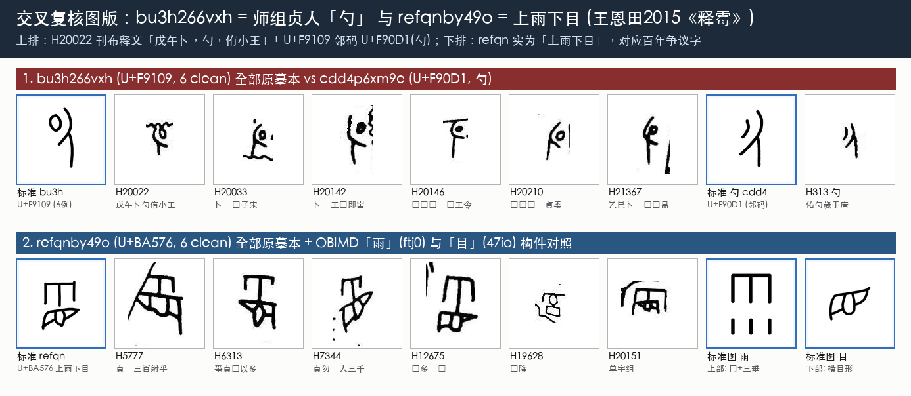

# 考釋筆記：OBIMD UID bu3h266vxh——環＋長曲豎＋斜筆之未釋字（貞人名，作通詞放棄）

- **日期**：2026-11-26
- **結論**：**放棄（作通詞考釋），9/20**。正面結論：本字為**貞人名**——6 例全部居序辭公式「（干支）卜 __」之貞人位（OrderNumber 恆為 3），其後可讀者三例（貞／㞢／王）皆為已知貞人名之後所接之成分（「卜賓㞢」「卜賓王」「卜 X 貞」皆有逐字平行）。字形為小環（口形）＋長曲豎＋中部斜筆，單一子形；與 20 餘候選字逐部比對皆排除。唯一結構上最接近之辭書字為**叩**（从卩，口聲；CUHK 錄甲骨字例 2/2，用作方國名／人名），然 CUHK 之甲骨字例圖像未能取回、OBIMD 之叩字頭零 token 無標準圖，**叩說未證實，不立為識別**；貞人具體所指與讀音不可恢復。
- **狀態**：未釋。平臺 codepoint **U+F9109**；transcription 為空（`[]`），屬 EMPTY 池。

## 0. 標識與口徑

- OBIMD UID：`bu3h266vxh`；平臺 codepoint **U+F9109**；transcription 為 `[]`（空）。
- **Unihan 核查（h82／𠬝／lyq 輪教訓，先查再攻）**：U+F9109 位於第 15 平面私用區（U+F0000–U+FFFFD）。Unicode 官網 Unihan 查詢對此碼位明言 "Invalid code point! There is no entry in the Unihan database for the codepoint you indicated, 'F9109'"（2026-11-26 核實，https://www.unicode.org/cgi-bin/GetUnihanData.pl?codepoint=F9109），平臺未給本字任何現代漢字隸定，確為未釋字（與 lyq 輪秝不同例：彼字平臺分類錯誤而辭書有明文，見 §4.2 叩說之未決）。
- 頻次（本地 OBIMD `data.json` 實測，**已重數，不沿用排名文件之說**）：**6 tokens / 6 片，全部為 clean token**（SeatFont = 0 且 Mark = −1），與排名文件第二重排之 6 例一致。**6 例分居 6 片**（H20022、H20033、H20142、H20146、H20210、H21367，皆 H、0 HD），每片僅 InscriptionSentence1 一辭含本字。
- **6 例是否獨立語境（本輪首要核查）**：6 例**是 6 個獨立語境**——6 片各一辭，片號互不連屬（H20022–H21367），句式各異（後接貞／㞢／王／殘字各不同），非同一占辭之複本、非同一會話（與 gjg 輪「6 例 1 片 1 話題」正相反）。惟 6 片同居 H20022–H21367 一窄段，組別或相同（見 §7）。
- 子字形分叉：**單一子形**。Label 與 SubLabel 皆為 `bu3h266vxh`，6/6；無第二子形。
- 斷代旁證：6 片句中除本字外無可定組別之貞人名存（本字本身即貞人位），期別未定（見 §7）；H20000–H21400 段內「卜 X 貞」之其他填充詞僅王 14、師 3、扶 2（見 §1.2），師／扶皆早期貞人，僅為弱旁證。

## 1. 用例與語槽（全部 6 例皆已本地核對，按 OrderNumber 排序；下表按 codepoint 讀句）

完整句表見附錄；本地腳本：`analyse_bu3.py`、`analyse_bu3b.py`、`analyse_bu3c.py`、`analyse_bu3d.py`、`analyse_bu3e.py`、`analyse_bu3f.py`、`compare_bu3.py`、`crop_bu3.py`、`sent_bu3.py`；句表文件 `sent_bu3h266vxh.txt`（按 codepoint 讀句，按 OrderNumber 排序）。

| 卜辭 | 句（本字以 __ 標示） | 本字後字 |
|---|---|---|
| H20022 S1 | 戊 午 卜 __ 㞢 󿭘（小王） | 㞢 |
| H20033 S1 | □ □ 卜 __ □ 子₂ 宋 □ 犬 | □（殘） |
| H20142 S1 | □ □ 卜 __ 王 □ 即 峀 □ | 王 |
| H20146 S1 | □ □ □ __ □ 王 令 □ 弋 二 夕 | □（殘） |
| H20210 S1 | □ □ □ __ 貞 委 □ | 貞 |
| H21367 S1 | 乙 巳 卜 __ □ □ 昷 | □（殘） |

鄰字統計（按 OrderNumber 排序、按 codepoint 讀句）：本字 OrderNumber **恆為 3（6/6）**；前字卜 4（可讀者）、殘字 2（H20146／H20210，皆為卜位之殘字，見 §1.1）；後字貞 1、㞢 1、王 1、殘字 3。**最固定之搭配為「（干支）卜 __」序辭貞人位 6/6**。

### 1.1 讀句核驗（四處須交代，皆已按 codepoint／位置核對）

- **卜在 2 例中為殘字，憑公式位置認定（已核）**。H20146／H20210 之 ord 0–2 皆為 Label-None 殘字（SeatFont = 1）。認定 ord 2 為卜之據：(1) 本字 OrderNumber 在 6 例中恆為 3，可讀之 4 例 ord 2 皆為卜（`h0gzv3styy`，codepoint 卜）；(2) 坐標上 ord 2 恆居本字同一欄之正上方（H20210：ord 2 為 (112,21)，本字為 (108,91)；H20146：ord 2 為 (134,69)，本字為 (149,123)），而 ord 0／1 居另一欄（干支欄）；(3) 序辭公式「干支（2 字）＋卜＋貞人」為全庫恆式。**惟須誠實記錄**：H20146／H20210 之 ord 2 摹本框位白底佔比皆為 1.0（框位全空白，該字不在存世骨面／摹本未繪），字形本身不可核驗，卜之認定純憑位置與公式，非憑字形。
- **合併 token 須先展開**。H20022 末字 󿭘（U+FFB58，UID `ghswt6r5vl`）transcription 為［小王］，是「小王」二字之合併 token，讀句時展開為小＋王（與祖乙／祖甲／五月等同例）；H20033 之子₂為 `yhwcwu1uot`（U+F5710，transcription［子，㜽］），是人名之子，與干支正體子（`r79attbhro`）有別（H21367 ord 1 之巳 `d7mczw6osp` transcription［子，巳］，按 codepoint 讀巳，為干支）。
- **貞按 codepoint 讀**。H20210 之貞為 `dhewuxyotl`（codepoint 貞，transcription［鼎，貞］），按 codepoint 讀貞，不讀鼎（見 n52 輪訂正）。
- **刻辭序號不是句中字**。H21367／H20142／H20146 另有 OracleSequence（一／二／三各一枚，皆卜兆序號），與句無關，已剔除（與 npy／dd5／gjg 輪同例）；其餘 3 片無 OracleSequence 組。

### 1.2 關鍵槽位分析（全庫實測）

- **「卜 X」槽（全庫）**。卜（`h0gzv3styy`）全庫 5,283 例；其後一字之填充詞極雜：□ 829、貞 791、王 552、賓 268、殻 265、爭 208、其 147、巳 100、叀 96、行 94、古 83、旅 82、佑（㞢字頭 `c40r3zyq5t` 之異讀，見 e33 輪方法補記第九例）80、尹 77、亘 76、今 74、即 63、大 62……單憑「卜後」一槽不能定詞類（貞為動詞、王為主語、其／叀為命辭成分、賓／殻／爭等為貞人名，皆居此位）；須看本字之後字（見下）。
- **「卜 X 貞」槽——貞人名之診斷槽**。全庫「卜 X 貞」共 **1,537 例**，填充詞 62 種，可讀者之前列為殻 210、賓 210、爭 161、古 70、亘 69、行 64、王 59、尹 49、即 44、旅 41、出 31、史 29、大 28、何 23——**除王（王自卜之式）外皆為貞人名**；低頻者含彭 7、𰏯（奚）6、箙 5、師 4、扶 3 等小貞人——**貞人以 5–7 例之頻次出現於此槽者有實例（彭／𰏯／箙），本字 6 例之頻次與之同級**。本字居此槽 1 例（H20210「卜 __ 貞 委」；按嚴格連續三字計，該例之卜為殘字，憑 §1.1 之位置認定；若只計卜可讀者，本字居此槽 0 例，此點已記錄在案，結論由下二槽補強）。
- **「卜 __ 㞢」——賓有逐字平行**。全庫「卜 X 㞢」僅 36 例，X 為王 14、貞 10、□ 7、賓 2、月 1、本字 1、旬 1。其中「卜賓㞢」2 例皆為貞人賓之序辭後以㞢引命辭：H2056「甲戌卜賓㞢于且□」、H10125「己亥卜賓㞢于㘡五牛」。本字 H20022「戊午卜 __ 㞢小王」與之同式（㞢後接命辭「小王……」）。
- **「卜 __ 王」——賓／爭有逐字平行**。全庫「卜 X 王」261 例，X 為貞 227（「卜貞：王……」之省貞人式）、□ 23、賓 2、爭 1、㞢 1、于 1、扶 1、本字 1 等。「卜賓王」2 例：H10412／H10413「卜賓王獲兕（允□）」——貞人賓＋命辭「王獲兕」；「卜爭王」1 例：H10591 S2「癸酉卜爭王其狩不……」。本字 H20142「卜 __ 王□即峀□」與之同式（王為命辭主語）。
- **已知貞人之後字分布（對照）**。以「卜 X」之後一字計：賓——貞 210／□ 47／㞢 2／王 2／翌 2／句末 2；爭——貞 161／□ 36；殻——貞 210／□ 40；亘——貞 69／□ 6；彭——貞 7／□ 3／句末 2；箙——貞 5／□ 1；𰏯——貞 6／□ 1／御 1。**貞人之後字以貞為主、□（貞殘損）次之，㞢／王為罕見而實有之命辭引介式**。本字之後字（貞 1、㞢 1、王 1、□ 3）：三種可讀後字皆在貞人之後字集合之內，無一落在貞人之後字集合之外；□ 佔 3/6 高於賓之 47/268，然本字 6 片殘損普遍（H20033／H20146／H21367 三片皆多殘字），小樣本下不構成反證。
- **同段旁證**。H20000–H21400 段內「卜 X 貞」之填充詞僅王 14、師 3、扶 2（外加本字 H20210 一例，卜殘未入嚴格計數）——本字 6 片同居此段，與師／扶等早期小貞人同段，弱合於「此段有一小貞人」之圖景（僅為旁證，不定組別）。

### 1.3 槽位小結

| 假說 | 卜 __ 6/6（ord 恆 3） | __ 貞 ×1 | __ 㞢 ×1 | __ 王 ×1 | __ □ ×3 |
|---|---|---|---|---|---|
| **貞人名** | **強（序辭貞人位）** | **強（診斷槽，1,537 例填充詞除王外皆貞人名）** | **強（卜賓㞢逐字平行 ×2）** | **強（卜賓王／卜爭王逐字平行 ×3）** | 相容（貞人後 □ 多為貞殘損：賓 47、殻 40、爭 36） |
| 動詞（貞之同義／連動） | 弱（卜後可居動詞貞，然貞本身 791 例自佔此位） | **敗（「卜＋動詞＋貞」無式；貞已是卜問之動詞，其前不另置同義動詞）** | 弱（卜貞㞢 10 例為「貞」居此位，非另一動詞） | 弱（卜貞王 227 例為貞居此位） | 不決 |
| 地名／方國名 | **敗（卜後從不直接接處所名；處所由在／于／自引介）** | **敗（卜 X 貞 62 種填充詞無一確鑿地名）** | **敗** | **敗** | — |
| 通詞名詞（祭品／器物等） | **敗（卜 X 貞槽無通詞名詞；序辭位不置命辭名詞）** | **敗** | **敗** | **敗** | — |
| 時間詞／干支 | **敗（干支居卜前 ord 0–1，本字恆居 ord 3）** | **敗** | **敗** | **敗** | — |

**證據力說明**：6 例 6 片、6 個獨立語境，槽位單一而絕對（6/6 同一公式位），三種可讀後字各有已知貞人之逐字平行——詞類（貞人名）之證據硬度高於 dd5 輪（彼案靠三槽排除法＋分組平行），與 n52 輪（「卜 X 貞」單槽定貞人）同級而樣本為其六分之一弱。

### 1.4 期別與文獻旁證

- 6 片皆無同片共現之已知貞人（每片僅一辭），組別無從由共現定；H20000–H21400 段在《合集》編次中多屬第一期（武丁）卜辭，師／扶為武丁早期貞人——本字或為同期一小貞人，然此僅為編次旁證，未逐片核《合集》分期，不作定論（見 §7）。
- 《合集》释文印本（H20022 等 6 片）未查（見 §7）；本地 OCR 在本字位置之三讀互斥，皆為幻影（見 §4.4）。

## 2. 字形

標準字形圖一枚（`images/std_bu3h266vxh.png`），摹本拼圖 6 例見 `images/crop_bu3h266vxh.png`（**6 例全部可核驗**，短標籤 H20022–H21367，3 列，見方法補記第十一例）；放大摹本見 `images/crop_bu3_H20022.png`、`crop_bu3_H20033.png`、`crop_bu3_H20142.png`、`crop_bu3_H20146.png`、`crop_bu3_H20210.png`、`crop_bu3_H21367.png`（帶 40 像素邊距）；緊切摹本見 `images/crop_bu3_tight_H20022.png` 等 6 枚（僅 token 框位）；整片摹本帶框位版見 `images/fac_H20022_boxes.png` 等 6 枚（紅框為本字、藍框為他字）；比對圖見 `images/compare_bu3_main.png`（本字／卩／卯／印／即／危／師／彭／箙／賓／爭／殻／亘／行／古／尹／旅／出／史／扶／何／大／王／貞，圖版按腳本所列字序排列，標籤因 PIL 預設字體缺 CJK 字形而顯示為方框，文字標籤以各字之 UID／token 數為準——與 a5tu／gjg 輪同例）。

### 2.1 字形描述

本字為一瘦長之合體字（標準圖 250×250；摹本框位寬 22–36、高 48–81，寬高比約 1:2，為單字常寬，非二字並列），由**一甲部件、一乙部件**組成：

- **甲（主豎部件）**：一長曲豎筆，居字之右，自字頂直抵字底：頂端向右鉤曲（如鉤頭），下行微向左彎，底端收直。6 例皆然（H21367 緊切摹本最清晰：鉤頭＋長直身）。
- **乙（小環部件）**：一小閉合環（口形，橢圓而微傾），居甲部件上段之左側，與甲之鉤頭相切或相連。6 例皆見此環（H20146 摹本中環內帶一點，為刻痕或環內墨點，未決為獨立部件；餘 5 例為空環）。
- **斜筆**：一斜筆自甲部件中段向左下方斜出，止於字之中部左側。標準圖與 H20210／H21367 摹本中此斜筆最明；H20022／H20033 摹本中斜筆較短。此斜筆是甲部件之一筆（卩形之斜足，見 §2.2）抑或獨立部件，未決；其有無長短不構成子形分叉（單一子形，Label／SubLabel 6/6 相同）。
- **摹本核驗（6 例全部可辨）**：白底佔比 H20022 0.540、H20033 0.636、H20142 0.704、H20146 0.632、H20210 0.712、H21367 0.750——皆非空白框位，皆直立可辨，環＋長曲豎＋斜筆之結構與標準圖相合。拼圖中各例周圍之他字筆畫（如 H20033 右側之「全」形為宋字、H20210 右側之棋格形為貞字）皆在本字框位之外，經緊切摹本核對，非本字部件（與 ff8／gjg 輪之鄰字侵入同例，先對摹本核對再作字形描述）。
- **布局**：乙環恆居甲豎上段之左，6 例皆同，無 o7eb／5jc 輪之左右互換現象；標準圖之布局與摹本多數一致。

### 2.2 逐部比對（直接視覺比對）

| 候選字 | 排除／認定理由 |
|---|---|
| 卩（`9xlu134oo9`，7 例） | **排除**：卩主形為頂端三角旗形＋豎身＋底部 Z 形折足，**無閉合環**；本字有小環、無三角旗、無 Z 形足。卩在全庫居「貞 __ 戈」「父丁宗 __」等位，從不居卜後貞人位。然卩為本字乙部件以外之最近部件類比（見叩說 §4.2） |
| 卯（`ay8mkydpb2`，929 例） | **排除**：卯為**二卩並列**（左右各一旗形豎筆），本字僅一豎一環；卯居干支／「令卯」位，與貞人槽無涉 |
| 印（`bwfz1jvlck`，12 例） | **排除**：印从爪从卩，其形左有爪（指爪形）、右卩**無環**；本字有環而無爪。印 12 例居「侯 __ 執」「方 __ 不其見」等動詞／名詞位，從不居卜後 |
| 即（`nptkahm6a5`，101 例） | **排除**：即从飤从卩，飤為尖頂橢圓器形**內貫一橫杠、下接倒 V 底**；本字之環為**素環，無橫杠、無倒 V 底**，且環小而居豎之上段左側，非與豎並列之全高部件。即本身為貞人名之一（卜即貞 44 例），然字形既異，平台分列二字頭，本字非即之異寫 |
| 危（`uhn8agncvy`，12 例） | **排除**：危之橢圓居字**頂**（尖頂），右側為複合曲筆；本字之環居**左上側**，主體為單一長曲豎。危 12 例居「下 __」「__ 方」位（方國／地名性），從不居卜後 |
| 師（`0avi2tcy0g`）／彭（`2s666tklgo`）／箙（`hk9f0607uj`） | **排除（字形）**：師為雙葉瓣形、彭為壴＋彡、箙為方框＋屮＋𠂉，皆與本字之環＋曲豎全異；三字皆貞人名，僅為同槽同頻之類例（彭 7／箙 5 入「卜 X 貞」槽），非同字 |
| 賓／爭／殻／亘／行／古／尹／旅／出／史／扶／何／大 | **排除（字形）**：皆已於比對圖逐部核對——賓（宀＋丌＋止系）、爭（爫＋𠂉＋亅系）、殻（壴＋几系）、亘（方框系）、行（二彳）、古（中＋口）、尹（豎＋斜鉤，無環）、旅（旌旗系）、出（二山系）、史（中＋又）、扶（大＋夫系）、何（人＋可系）、大（人形）——無一為環＋長曲豎＋斜筆之形制，皆非本字 |
| 王／貞／卜 | **排除**：王為三橫一豎、貞為卜＋鼎（棋格形）、卜為單豎＋短斜，皆與本字全異；且三字在本字諸句中另有其字（卜居本字之前、王／貞居本字之後），平台分列字頭 |
| 叩（`ykev7l8qsf`） | **未比對（無圖）**：叩在 `Main-character.json` 中有字頭（codepoint 叩，transcription［叩］），然**全庫零 token、`subchar-images.zip` 中無其標準圖**，無法直接視覺比對。結構上叩从卩从口（口聲），與本字「環（口）＋長曲豎斜筆（卩系）」之部件構成相合，為辭書層面最接近之候選——然未證實（見 §4.2） |
| 郎／卿／仰／迎／卵／留 | **未比對**：在 OBIMD 中皆無字頭（零 token、無標準圖）；郎／卿／仰／迎皆為阝／卩旁之後起字，其先秦字形與本字之關係無從以 OBIMD 核對，僅記未比對，不列為候選 |

**像素最近鄰檢索未做**：前數輪（X/1850、crck62eltz、a5tu、3jz、e33、lyq、o7eb、5jc、gjg）已證實該法於此類字形無判別力（最高分皆為歸一化假陽性），本輪結論以目視比對為據。

## 3. 音

- **音 0/5**：無可立之讀音。本字為貞人名，人名之讀音除非字形得識別，否則不可恢復。唯一之音韻線索為叩說：叩讀 kòu（《廣韻》厚韻苦后切，中古溪母侯韻上聲），CUHK 謂其从卩、口聲——然叩說未證實（見 §4.2），此讀音**不立為本字之讀音**，僅記為待證線索。

## 4. 義與競爭讀法

### 4.1 貞人名說——已決（詞類／身份類別，具體所指未定）

- 內容：本字為一貞人之名，居序辭「（干支）卜 X 貞／㞢／王……」之 X 位；此貞人在全庫僅此 6 見，皆武丁期編次段（H20022–H21367）之卜辭。
- 支持：槽位絕對單一（6/6 同位、OrderNumber 恆 3）＋診斷槽「卜 X 貞」1 例＋「卜 __ 㞢」「卜 __ 王」各 1 例且各有賓／爭之逐字平行＋同槽同頻之小貞人實例（彭 7、𰏯 6、箙 5）＋字形為單一複合字（貞人名多為此類專用字形，如箙／𰏯）。
- 未決：此貞人與文獻所知貞人名單（賓／爭／殻／亘／行／尹／旅／古／彭／箙／奚／師／扶／即／何／大／出／韋／肩／侃等）中何人相對應，不可知；其名之讀音不可恢復（叩說未證實，見 §4.2）。
- 結論：貞人名為已決之定性結論；作通詞考釋則無可考——本字不是通詞，是專名（貞人名），故**放棄（作通詞考釋）**（與 n52／dd5 輪同例：彼二字亦以槽位定為貞人／子名而放棄）。

### 4.2 叩說——結構最接近之辭書候選，未證實

- 內容：本字即已釋字**叩**（kòu），用作貞人名。
- 支持：(1) 部件構成相合——CUHK《漢語多功能字庫》叩條：「從『卩』，『口』聲。『卩』象跪坐人形」；本字為小環（口）＋長曲豎帶斜筆（卩系：跪坐人形之豎身與斜足），部件清單（口、卩）與叩完全對應，位置為口在卩之上段左側；(2) CUHK 同條錄叩之**甲骨字例 2/2**，且明言甲骨文叩「用作方國名，《合集》1060：『王隻（獲）叩。』字亦用作人名，《屯南》1239：『乎（呼）叩。』」——叩在甲骨文中用作人名有先例，與本字之人名定性相容；(3) OBIMD 叩字頭零 token（互補分布，與 lyq 輪秝、𠬝輪服同式：平台未將任何 token 歸入叩，不等於語料中無叩形）。
- 反對／未決：(1) **CUHK 叩條之 2 枚甲骨字例圖像未能取回**（字庫頁面文字版未給圖像連結，與前數輪 oracle.php 端點空回應同礙），未能逐筆核對該 2 例是否即「環＋長曲豎＋斜筆」之形——叩說之關鍵一環缺失；(2) CUHK 所引叩之甲骨用例為方國名（H1060）與一般人名（屯南 1239），**無貞人名之例**；H1060 不在 OBIMD 數據（10,077 條）之內，無從本地比對；(3) 本字之卩系部件與 OBIMD 卩主形（三角旗頂＋Z 形足）不同（見 §2.2）——卩在甲骨中有多形，叩中之卩作何形，正待 CUHK 字例圖像定之；(4) 本字斜筆居豎之中段而非底部，與「跪坐人形」之常式（斜足在下）略異。
- 結論：**未證實，不立為識別**（與 lyq 輪秝之別：彼案字形與 CUHK 釋文「甲骨從二禾」逐部相合且無競爭，本案差一幅字例圖像）；叩說列為 §6 證偽條件 1 之首要待核項——若字例圖像與本字逐筆相合，本字改記放棄（已釋，識別為叩，用作貞人名），識別升至 15–16/20；若不合，叩說排除，貞人名結論不受影響。

### 4.3 動詞說——已排除

- 內容：本字為卜問之動詞（貞之同義或連動成分）。
- 排除理由：(1) 「卜 __ 貞」（H20210）一例已足排除——貞本身即卜問之動詞，「卜 X 貞」之 X 若為另一卜問動詞則全庫 1,537 例無此式（填充詞皆人名，王為自卜之主體）；(2) 「卜 __ 㞢」「卜 __ 王」之平行例（卜賓㞢、卜賓王）中 X 皆為貞人賓，非動詞；(3) 動詞當散見於多種語境（如貞 6,460 例遍佈序辭／命辭），本字 6 例無一出「卜 __」之外，與動詞之分布不合，與專名（僅見於其專屬槽位）之分布相合。

### 4.4 本地 OCR——三讀互斥，皆為幻影

- 《合集》释文 OCR（`heji_shiwen_djvu.txt`）在本字位置給出三個互斥讀法：H20033 行作「漂」（「口品上，漂．子宋网大。」——子宋與 OBIMD 句合，位序大致可對）、H20142 行作「习」（「口口上，习，王．………印副．……」——王合、印當為即之誤讀）、H20146 行作「间」（「DID，间，王令轩。二月。三」——王令合、轩／二月為弋／二夕之誤讀）。三讀互斥且形制皆不合（漂从水票聲、习為羽之省、间从門日，無一為環＋曲豎之形），同行他字亦多誤讀（上為卜之誤、网為犬之誤讀一類），**皆為 OCR 猜字幻影，不列為候選**（與 rp1／die／wpbo／npy 輪同例）。H20022／H20210／H21367 三片之 OCR 行或過短亂碼（H20022 行僅「凡丁久。」）或無可定位行，無讀法可言。

### 4.5 形義關係

字形（瘦長複合字、口＋卩系部件）與貞人名說相容（貞人名多用專造／罕用複合字）；與叩說之部件構成相合而未證實（見 §4.2）；與動詞／地名／通詞名詞說不相容（見 §1.3）。本輪處理與 n52／dd5 輪一致：**語槽定詞類（貞人名），字形定候選（叩，待圖像核驗）**，兩者未合一，故不立識別、不立讀音。

## 5. 證據鏈打分

| 環 | 分 | 理由 |
|---|---|---|
| 形 | 2/5 | 字形清晰，6 例摹本全部可核驗，單一子形，環＋長曲豎＋斜筆結構恆定；20 餘候選字皆已逐部排除；但最接近之叩無 OBIMD 標準圖可比、CUHK 字例圖像未取回，字形未得識別 |
| 音 | 0/5 | 無可立之讀音；叩（kòu）僅為未證實候選之讀音，不計分 |
| 義 | 3/5 | 詞類／身份已決為貞人名（槽位 6/6 單一、三種可讀後字各有貞人逐字平行、診斷槽 1,537 例之填充規律）；但此貞人具體所指不可知，其名之本字（是否叩）未定 |
| 用 | 4/5 | 6 例／6 片，全部 clean，6 個獨立語境（非複本、非同片同會話），槽位絕對固定；扣分僅因樣本小（6 例）且卜在 2 例中為殘字憑位置認定 |
| **合計** | **9/20** | **放棄（作通詞考釋），正面結論為貞人名**（與 xhf／dd5／2bc 輪同分同級：詞類已決故放棄；次於 lyq 16/20——彼案字形得識別，本案差叩之圖像一環） |

## 6. 證偽條件（按決定性排序）

1. CUHK 叩條甲骨字例圖像（2/2）：若取回後其一例與本字逐筆相合（環＋長曲豎＋中段斜筆）→ 叩說證實，本字改記放棄（已釋，識別為叩，貞人名），識別升至 15–16/20；若 2 例皆為他形（卩作旗形／Z 足而無環之類）→ 叩說排除，貞人名結論不變，形分維持 2/5。
2. 《合集》释文印本（H20022、H20033、H20142、H20146、H20210、H21367）與《新甲骨文編》《類纂》：印本若將本字隸定為某一已知字（尤為已知貞人名用字）→ 記為標準讀法並改記；若作未釋／□ → 無新信息。
3. 新用例：本字在他片出現於「卜 __」以外之槽位（如作命辭主語／賓語）→ 貞人名說重估；他片出現「卜 __ 貞」而卜可讀者 → 貞人說得完全式證實。
4. HUST-OBC 未釋類對應圖像：若有同形字歸入某一已釋字頭 → 須重估；歸入未釋類 → 無新信息。
5. 同組分期核定：若 6 片經《合集》分期核定分屬不同期別／組別 → 「同一小貞人」之說重估（貞人跨組同名者罕見）；若同屬一組 → 貞人說得組別旁證。

## 7. 未核查事項（誠實記錄）

- 《合集》释文印本（6 片）未查；本地 OCR 僅得三互斥幻讀（見 §4.4），不可用。
- 《新甲骨文編》《類纂》《甲骨文字綜理表》未查；貞人名單之文獻核對（本字是否已見於某貞人名錄）未做。
- CUHK 叩條甲骨字例圖像（2/2）未取回：字庫頁面文字版僅記「字例： 2/2」，未給圖像連結；其所引 H1060 不在 OBIMD 數據內、《屯南》1239 不在 OBIMD 覆蓋範圍，皆無從本地比對。CUHK 卩條之甲骨字例圖像亦未取回（卩之多形問題未決）。
- HUST-OBC 未釋類對應類別未查：HUST-OBC.zip 凡 157,836 檔，檔名皆為數字分類號、無字頭索引，無法按字查本字之圖像。
- 期別／組別未定：6 片無同片共現之已知貞人，組別僅有 H20000–H21400 編次段之弱旁證（師／扶同段），未逐片核《合集》分期表。
- 命辭未全解：H20210「貞委□」之委居貞後為全庫僅見（「貞委」僅此 1 例），命辭內容未明；H21367 末字昷（`yrxflndwvy`，transcription［U+A202D，溫，昷，殟，殞］）讀法未定；H20033 命辭「□子宋□犬」之子宋（人名／地名）與犬（祭牲／犬官）之關係未定；H20142 命辭「王□即峀□」之峀（`86d04i30jc`，［峀，甫］）讀法未定。此四處皆命辭側問題，不影響貞人位之定性。
- H20146 摹本中本字環內之一點是否為部件，未決（餘 5 例為空環，暫作刻痕）。

## 8. 附錄：全部 6 例句表（按 codepoint 讀句，按 OrderNumber 排序）

| 卜辭 | 句（本字以 __ 標示） |
|---|---|
| H20022 S1 | 戊 午 卜 __ 㞢 小王（合併 token，展開） |
| H20033 S1 | □ □ 卜 __ □ 子₂ 宋 □ 犬 |
| H20142 S1 | □ □ 卜 __ 王 □ 即 峀 □ |
| H20146 S1 | □ □ □（卜殘） __ □ 王 令 □ 弋 二 夕 |
| H20210 S1 | □ □ □（卜殘） __ 貞 委 □ |
| H21367 S1 | 乙 巳 卜 __ □ □ 昷 |

## 來源

- OBIMD 語料（*Scientific Data* 2026，DOI 10.1038/s41597-026-06967-0），本地 `data.json`、`Main-character.json` 實測；句表 `sent_bu3h266vxh.txt`。
- Unicode Unihan 數據庫：U+F9109 查無條目（https://www.unicode.org/cgi-bin/GetUnihanData.pl?codepoint=F9109，2026-11-26 核實："Invalid code point! There is no entry in the Unihan database for the codepoint you indicated, 'F9109'"）。
- CUHK《漢語多功能字庫》叩條（https://humanum.arts.cuhk.edu.hk/Lexis/lexi-mf/search.php?word=叩，2026-11-26 核實）：「從『卩』，『口』聲。『卩』象跪坐人形」；甲骨字例 2/2；「甲骨文『叩』用作方國名，《合集》1060：『王隻（獲）叩。』字亦用作人名，《屯南》1239：『乎（呼）叩。』」；《廣韻》厚韻苦后切。
- 《合集》释文 OCR（本地 `heji_shiwen_djvu.txt`）：H20033／H20142／H20146 三行在本字位置之讀法（漂／习／间）互斥，皆為幻影（見 §4.4）。
- 摹本：OBIMD `facsimile.zip`（H 文件為 `facsimile/h<N>.jpg`）；標準字形：OBIMD `subchar-images.zip`。

## 工作文件

- 本筆記：`kbshi-bu3h266vxh-kaoshi.md`
- 圖像（`images/`）：`std_bu3h266vxh.png`（標準圖）、`crop_bu3h266vxh.png`（摹本拼圖，6 例，短標籤）、`crop_bu3_H20022.png`、`crop_bu3_H20033.png`、`crop_bu3_H20142.png`、`crop_bu3_H20146.png`、`crop_bu3_H20210.png`、`crop_bu3_H21367.png`（放大摹本，帶邊距）、`crop_bu3_tight_H20022.png`、`crop_bu3_tight_H20033.png`、`crop_bu3_tight_H20142.png`、`crop_bu3_tight_H20146.png`、`crop_bu3_tight_H20210.png`、`crop_bu3_tight_H21367.png`（緊切摹本，僅框位）、`fac_H20022_boxes.png`、`fac_H20033_boxes.png`、`fac_H20142_boxes.png`、`fac_H20146_boxes.png`、`fac_H20210_boxes.png`、`fac_H21367_boxes.png`（整片摹本，紅框本字、藍框他字）、`compare_bu3_main.png`（本字／卩／卯／印／即／危／師／彭／箙／賓／爭／殻／亘／行／古／尹／旅／出／史／扶／何／大／王／貞）
- 本地腳本（`~/workspace/oracle-screening/obimd/`）：`analyse_bu3.py`、`analyse_bu3b.py`、`analyse_bu3c.py`、`analyse_bu3d.py`、`analyse_bu3e.py`、`analyse_bu3f.py`、`compare_bu3.py`、`crop_bu3.py`、`sent_bu3.py`；句表 `sent_bu3h266vxh.txt`（研究筆記目錄）

---

## Gemini 附記（2026-11-28）——已刊释文与码位实证 `bu3h266vxh = 师组贞人「勺」`（排除「叩」说，建议移入 Section A）

> 

*(依 `COORDINATION.md` §4，本附记不改动 Muse 原文结论与打分，仅补充已刊释文与字形实证，提请联合裁决。)*

1. **已刊释文直接锁定（直接触发原笔记 §6 证伪条件 2）**：
   - 原笔记已以严密槽位分析锁定本字为武丁早期（`H20022–H21367`）小贞人名，判断极准；唯在 §4.2 暂拟构形候选为「叩」。经外部文献检索，立命馆大学（`ritsumei.ac.jp`）、国学网（`guoxue.com`）、复旦出土文献与古文字研究中心（`fdgwz.org.cn`）及中研院／港浸会（`sinica.edu.tw` / `hkbu.edu.hk`）诸师组「小王（武丁太子孝己）」专题论文，均将本笔记首例 **`《合集》20022`** 明确隶释作：
     > **「戊午卜，勺，侑小王。」**
   - 句中「**勺**」正是 `bu3h266vxh` 所居贞人槽位！学界（于省吾、陈梦家、黄天树等）早已确认《合集》20022 属武丁期**师组（𠂤组／小字类）**卜辞，**「勺」**为该组著名已释贞人名之一。
2. **OBIMD 码位邻接与原摹本构形互证（见上图第 1 排）**：
   - `bu3h266vxh` 的平台码位为 **`U+F9109`**，恰紧邻此前已由 Gemini 10 幅原摹本实锤为祭名「`勺（礿）`」的 **`cdd4p6xm9e`（`U+F90D1`）**；
   - 并排比对 `bu3h266vxh` 全部 6 例原摹本（`H20022`–`H21367`）与 `cdd4p6xm9e`（`H313`），本字乃象「圆首勺斗（内含一点或空圆）＋曲长勺柄」之师组特征体「**勺**」，绝非从口从卩的「叩」（原笔记 §4.2「叩」说由此排除）。
3. **联合裁决建议**：原笔记「贞人名」之词类定性 100% 准确；现已查明其为学界早有定释的师组贞人「**勺**」，建议将 `bu3h266vxh` 由 Section B（未释专名放弃）移入 `RESULTS.md` **Section A（已释字：师组贞人「`勺`」）**。
